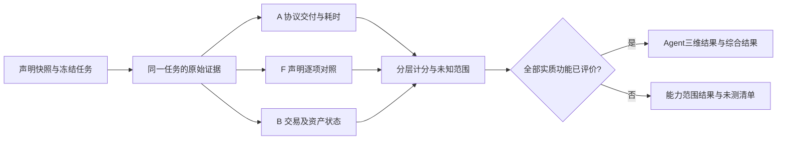

# ADR-0025：共享任务、声明覆盖与可解释三维评分

日期：2026-10-27。设计版本：`transaction-agent-evidence-v1 / design-0.1`。

状态：设计方案，尚未接入评分引擎、冻结正式新采样或发布新分数。用户已授权重新设计，并允许必要付费实验；本方案不覆盖原有政策与历史报告。核心代码、Schema及数据库此次不变。

## 1. 评价对象与“完整”的定义

评价单位为“公开注册身份＋声明快照＋服务版本＋观测窗口”。注册链、执行链、服务入口、提供方、签名方、执行账户与协议合约分别保存。五类材料必须有来源和缺口：注册信息用于定位归属，声明定义应做什么，接口提供真实行为，合约定义实际执行路径，交易及状态证实做了什么；注册成功或文件数量本身不加声誉分。

先读取登记资料、官方Agent Card、被明确关联的官网与业务文档，形成该身份的实质声明清单。官方页面变化、API/V4合约版本差异和归属强度保留，不能把同品牌另一身份的能力并入，也不能因一个接口只支持少量功能而删掉该身份其它公开功能。

区分以下概念：

- **能力范围报告**：只对列明功能和条件评价，例如Base ERC20即时兑换。三维齐备仍不叫Agent整体完整。
- **Agent声明覆盖完整**：本版收集到的全部实质功能、承诺与必要案例均有可判证据；未测、未适配、条件不明均阻止此状态。已证实失败也属于已评价，完整不等于全部通过。
- **样本不确定性**：即使声明代表案例覆盖了，少量实验也不能证明所有参数组合或长期表现。原始未知观测仍可使得分呈区间。

未测功能不得标为NOT_APPLICABLE；只有逻辑上确实不适用的项目可以排除，并附来源。例如真实只读查询没有资产交易，不编造执行交易；缺钱包、缺适配和尚未调用均是覆盖缺口。

## 2. 统一任务、分别判定

一个任务保存一套可追加的事实：

```text
task_id / registration / capability / service_version / scenario
intent：链、资产或状态目标、金额、收款人、授权、费用和时间约定
claims：适用的有来源声明与适用条件
events：业务请求→响应→方案→模拟→签名角色→广播→回执→资产/状态
assessments：A交付；F各声明；B真实履约，各自附证据与归因
outcome：完成 / 拒绝 / 保护退出 / 未执行 / 待定
attribution：提供方 / 操作者 / 网络路径 / 链或市场 / 未明
```

`task_id`全局稳定；判据在`(task_id, dimension, criterion_id)`内去重。同一任务可以同时支持A、F、B，不伪装成三次独立实验。挑战、付款、approve与swap等步骤不拆成多个业务任务。重放同一原件不增加样本数。



三维相关，不能宣称统计独立。一次无响应通常令A记录未交付、F缺少输出、B未执行；不能机械地产生三个FAIL。只有分别存在明确的义务违背，才在各自维度记录失败，例如错误收款人既出现在方案又在真实执行中造成错误到账。

## 3. A：服务可用性

问题：按正确调用条件发出请求后，服务能否在事先约定的观察时限内，交付完整、可解析的协议响应？本指标描述本次测量线路下的访问体验，提供方故障归因另记。

主指标改为**按时完整协议交付率**，取消旧版80/20及1秒至10秒线性打分。p50、p95、超时和断连次数作为同维度辅助指标原样展示，不再用没有校准依据的比例揉成分数。

正常业务与故意设计的边界拒绝分层记录；大量廉价拒绝不能按调用次数抬高正常业务的A。采样前冻结每个案例的权重和有效性门禁。当前三次socket异常是否为有效已发调用尚需原件核查，`fetch`开始不证明请求离开客户端；28/31只能作客户端完整返回计数，不直接重算本版A。

| 事实 | A结论 | 与其它维度关系 |
| --- | --- | --- |
| 合法业务响应按时完整返回 | PASS | 不说明内容正确或实际成交，继续F/B |
| 按公开规则对无效输入明确拒绝 | 对预先设计的拒绝案例为PASS | 可支持F边界验证，不能算成交成功 |
| 有效业务请求已发出，测量有效，断连/超时未完成交付 | FAIL（未交付），归因可为UNKNOWN | F缺源，B未执行；不宣称提供方处理故障已确定 |
| 确认是本平台前置故障、未备妥授权/资金、误用凭据而未形成有效调用 | MEASUREMENT_INVALID，不入A观测分母 | 保留计划缺口，不能补成Agent成功 |
| 是否有效发出或测量环境有效性无法确认 | UNKNOWN | 保留证据范围，不为归责不明自动补成功或失败 |

请求有效性和排除理由按预定规则决定，不能在看到失败后临时改变。x402正常挑战、目录或RPC在线不等于业务交付；付款失败前未真正进入业务调用须单列。已发请求的实际状态未知先核对付款/nonce，不自动付费重试。

采用Google SRE“好的事件/有效事件”的可用性思路；但“完整交付”和“内容语义正确”在本项目分开，后者进入F。[Google SRE](https://sre.google/workbook/implementing-slos/)

## 4. F：功能声明一致性

问题：实际结果是否兑现**该身份在相应入口与条件下的具体声明、接口契约和已接受任务约定**？

先做“功能→规范化声明组→必要案例”矩阵，固定后采样。独立用户目标定义功能，营销句子数和接口数量不定义功能；即时兑换的approve、报价、模拟、成交是步骤，不能拆成四个功能增加覆盖。

同类兑换Agent共用声明组和判据，例如：

- 支持链与资产：原生币/封装币、地址、精度、输入输出是否一致；显示ETH而实际交付WETH须进入资产标识条款。
- 输入与输出约束：数量、收款人、最小到账、路由类型、报价与实际calldata是否对应。
- 授权与边界：接受任务的权限范围、危险或不支持输入是否按公开规则处理。
- 费用、时效与执行模式：服务费、协议费、免gas的适用钱包/入口、即时/限价/定时/周期功能是否兑现。

这些是通用检查领域，只有对应公开声明、接口契约或任务约定的具体条款才入该Agent矩阵。不能把未声明的“全市场最优价格/必定盈利”塞进评分，也不能把已有承诺放到不计分的诊断区掩盖。

每个声明组先规定正常场景、区别显著的支持模式和必要边界。例如支持两个路由，应分别取证；原生ETH与WETH不属于同一个可互换的资产案例。正常输入失败与安全拒绝不支持输入分别判定。

F每个判据：PASS表示独立证据支持兑现；FAIL表示存在明确矛盾；UNKNOWN表示资料、适用条件或独立核验尚缺；NOT_APPLICABLE仅表示有证据表明逻辑不适用。没有收到输出是缺证据，不能再判一次“输出错误”。模拟仅证明对应固定区块的可执行性，不能冒称真实成交。

## 5. B：交易行为可靠性

问题：真实链上行为是否与已接受任务、授权和承诺的终态一致？不以价格涨跌、收益或外层receipt.status单独给分。

对即时兑换、条件订单、定时订单、支付等分别使用协议适配，但共用以下义务：

1. 原任务、方案、签名角色、执行账户、链与真实交易对应；中断先reconcile，不盲发第二笔。
2. 实际目标/方法、输入金额、收款人和输出或状态满足约定；用交易级事件与状态核验，块级余额差只交叉佐证。
3. 权限与资产边界守约：授权范围、非约定转出、重复执行、委托变化、残留授权；精确授权是否强制由明确任务约定决定，不把平台偏好伪装成提供方原承诺。
4. 服务费、协议费、网络费分别按实际证据记账；手续费上界仅在事先存在明确约定时据此判违约。
5. 订单状态、执行时间、撤单/退款和过期行为真实；“已创建/待执行”不等于完成兑换，“交易成功”不等于业务完成。
6. 区块规范性与链对应的确认/最终性得到核验，未达到要求为待确认，不自动判失败。

PASS为真实终态符合任务；FAIL为有证据的履约或资产/权限违约。责任不明的执行失败保留真实结局与UNKNOWN，不能猜测归责。由平台自身签错或改错方案造成的事故单列平台问题。

正常滑点保护导致回滚：记录“未成交、保护生效、实际gas”。它可以证明保护条款，但**不计作正常兑换成功，也不无依据判Agent违约**；若本次未产生可判履约，作为中性保护退出保留，所需正向执行案例仍未完成。请求撤单的任务则以撤单状态与应退资产为自己的目标。不能靠大量拒绝或回滚取得完整B。

所有已受理执行意图都保留在结局台账，展示完成数、保护退出数、违约数、未决数及真实完成率。保护退出的结局已知，不能塞进UNKNOWN制造“可能其实成交”的区间，也不能删除后只报剩余交易100%成功。

例：若100个意图中只有1个完成、99个合法保护退出，则真实完成率为1%，违约数可为0。若其余必测正常目标尚未进入可判执行，主卡显示“正常履约证据未齐”，已核保护约束作为辅助事实；不以1/1报完整B100。若99个本来就是预先设计的保护测试，它们只增加保护条款证据，不增加正常业务权重。补证条件取决于被冻结的正常案例/重复采样目标，不根据退出多少临时设门槛。

Uniswap公开说明最低到账保护可能使交易回滚；这与“收到较差价格仍成功成交”不同。[Uniswap交换保护](https://developers.uniswap.org/docs/get-started/concepts/traders/swaps)

## 6. 分数、UNKNOWN与覆盖：统一算法

先在**同一功能、同一判据、同一预定案例**内计算。记P为通过、V为明确失败、U为未决，n=P+V+U：

```text
已判符合率 q = 100P/(P+V)           （P+V=0则不显示）
可判观测覆盖 c = (P+V)/n           （n=0则尚无观测）
当前观测结果界 I = [100P/n, 100(P+U)/n]
```

结果界仅表示当前未知结论全部不满足/全部满足时的可能范围，不是统计置信区间；不能拿下界当处罚分，也不能把中点当精确分。计划未执行不虚构成一次观测；该案例尚无观测时范围为[0,100]且标NOT_RUN。中性保护退出与不适用单列，不算真实完成；不能借排除它们隐藏正向执行覆盖缺口。

具体执行结果与判据未知分开：已知保护退出不属于这个公式的U；它留下的是相应正常案例未完成的覆盖缺口。B的主结果发布先检查必要正常履约案例及预定观测目标，未齐则不以已判子集生成完整B主分。真实完成率始终以完整的有效受理执行意图台账为分母，辅助的约束符合率也必须标明实际覆盖数。

若有U，主卡显示范围和未决原因，例如“80–100，10次中2次未决”，不把q=100单独放成“100分”。已知失败仍明确拉低上界，例如8P/1V/1U的范围为80–90；后续不能只补成功请求稀释或删除该失败。

为说明声明覆盖的作用：假设某功能冻结了5个等权声明组，3个明确符合、1个明确不符、1个未测，则该功能F的可能范围是60–80，不是把未测组删掉后报75，也不是将未知直接记0而报60。这里是算法示例，不是MangoSwap实际新分。

聚合先固定权重，再分别计算上下界：

- 同一案例的重复请求只增加该案例的观测，不增加功能/声明权重。
- F按规范化声明组等权，组内必要案例等权；避免一个声明拆成十句或多测十次就改变其重要性。分组规则由同类能力蓝图固定。
- 功能内A/B按预定案例等权；Agent层对独立用户功能等权，B只聚合实际适用的写入功能，A/F仍覆盖其它功能。没有实际使用分布时，这是透明的默认产品取舍，不声称天然最优；新增功能须在观测前更新快照和计划。
- 总体仍为`R=0.30A+0.40F+0.30B`；若维度有区间，在声明覆盖完整时可展示`[0.30A_L+0.40F_L+0.30B_L, 0.30A_H+0.40F_H+0.30B_H]`。这是保守结果界，不是三维独立概率模型。
- 声明覆盖不完整时，只给已有功能范围分；**不发布Agent完整综合分**，不重分配维度权重。已满足前置条件并进入目标机制的明确失败可以完成该案例评价；用错入口、输入不满足触发条件或提前被安全拒绝不能假装正常案例已评。

等权和30/40/30都是价值选择：前者防止测试次数与营销篇幅决定权重；后者保持已确认的“更重功能兑现”目标。A占30%也明确包含本平台测量环境的体验，不称提供方固有故障率。不得用事后拟合的权重让MangoSwap变高或变低。错收款人、越权转出等已证实重大违约会强制将呈现状态改为“存在重大资金/权限违约”、取消正常绿色推荐标识，并从默认高分推荐中移出，分数仍公开，不能只在脚注提醒；不临时发明“扣到59分”的上限。

## 7. 完整性与阈值的依据

| 参数/门槛 | 本版选择 | 依据与限制 |
| --- | --- | --- |
| 维度权重 | 30/40/30 | 已确认产品取舍，功能兑现稍重；不是老师规定或统计估计 |
| Agent完整覆盖 | 该身份所有实质功能及其必要声明案例均有可判证据；写入功能有真实执行结局 | “评价完整”的语义要求；失败也可形成可判结论。未测或缺适配不算排除理由 |
| 统一样本数 | 不沿用7次/80%作为万能完整门槛 | 数量不能替代功能覆盖；所需次数由案例与所需估计精度决定 |
| 同步报价接收时限 | 提供方明确约定优先；没有时，同类即时接口暂用30秒主判定时限 | 工程测量预算，非科学最佳值；同一原请求可保留观测至60秒，以分析15/30/60秒敏感性。未实际观察的区间标不可评估，不为敏感性重发付费请求；采样前冻结 |
| 异步订单时限 | 采用任务及公开执行/到期约定 | 不能把30秒套在定时订单上；没有明确最大执行延迟时，超观察窗只能说明尚未证明自动完成，不能凭空宣布违约 |
| 金额/地址 | 按实际链、地址、整数单位及明确取整规则精确匹配 | 来自链上语义与任务，不允许用浮点误差掩盖资产差异 |
| 滑点/最低到账/费用 | 采用具体任务接受值与真实合约保护 | 不是全平台固定0.5%；当且仅当存在承诺才据此判违约 |
| 确认要求 | 链特定配置，明确included/safe/finalized；优先验证可用的finalized块 | 不将旧64区块说成所有链同等最终性；等待状态不扣分 |

Base区分unsafe、safe和finalized，L2最终性依赖对应L1数据；简单区块数量不能冒称同等终局保证。[Base派生与最终性](https://docs.base.org/base-chain/specs/protocol/consensus/derivation)

功能案例覆盖与统计精度分开。对有明确采样分布、可合理视作独立且成功概率相近的重复实验，可给95% Wilson区间；95%是报告惯例而非事实保证。刻意选择的混合案例、同一钱包/线路上的关联任务，不直接合并成长期成功概率。

例如在二项模型假设下，7/7成功的双侧95% Wilson下界约64.57%，12/12约75.75%。这说明“七次全过”不足以证明长期接近100%，不是要求每个功能机械补到某个新次数。若需要声称某可靠率，须先声明目标、误差、采样分布和停止规则，不能边看分数边加样本。[NIST比例区间](https://www.itl.nist.gov/div898/handbook/prc/section2/prc241.htm)、[二项模型条件](https://www.itl.nist.gov/div898/handbook/eda/section3/eda366i.htm)

在设计评审中对功能等权/声明分组和维度权重做敏感性分析；保持功能权重不变，分别比较30/40/30、三维等权以及各维度主导的边界。结论若随合理取舍大幅变化，展示敏感性，不包装成稳定排名。OECD/JRC手册要求关注权重、缺失值与聚合选择对综合指标的影响，本项目据此采用透明性审查，未声称权重已经过大样本验证。[OECD/JRC手册](https://www.oecd.org/en/publications/handbook-on-constructing-composite-indicators-methodology-and-user-guide_9789264043466-en.html)

## 8. MangoSwap：一笔任务怎样同时进入三维

原B01，task_id=`308b77db-c3ec-4662-a41e-361131e66ebd`：0.1USDC换WETH，Base，滑点50bps，收款为专用买方。真实交易`0x9b9ebb99c975109e715c78ad597139f44fe5735e29dacbb8bfb62d6a9c935135`。

- A：完整业务响应2254.0404ms，可以支持该API入口的交付与延迟观察，旧版只因为purpose=B没有用于A。
- F：真实代币、金额、收款、授权和最低到账有正面证据；服务把WETH显示为ETH，资产展示一致性条款有负面证据。不能再把这项已知问题放在主分之外。
- B：链上实际收到0.000043001356465853WETH，高于最低0.000042827285279623，转账、池事件和授权符合原任务，可支持该即时兑换的真实履约。

同笔不是三个独立样本。F存在标签问题不自动使本来按WETH意图正确到账的B变失败；反过来B到账正确也不能抹去F的描述问题。

旧F的12P/0V/2U，在原有限任务分母上只能说明未决界85.71–100，不能据此生成本版Agent的F。完整新F还缺其它声明及案例。当前官网另有条件订单、定时/周期与管理声明；因此**当前不发布MangoSwap的新Agent完整总分**。详细清单与补证顺序见[声明矩阵](../research/MANGOSWAP_DECLARATION_MATRIX_20261027.md)。

## 9. 复用、实验与迁移

复用单位是能力/协议：即时兑换、条件订单生命周期、定时/周期生命周期等蓝图；对象配置只提供有来源身份、入口、链、合约、资产与声明条件，不出现按MangoSwap名字判分。应先核同类对象声明与可得证据，再实现覆盖价值高的适配。

先重放有效旧原件和已有失败发现，补实验只为解决具体缺口。现有API七笔不重跑来证明同一事情；新增V4入口、native ETH路径、条件/定时功能不能用旧Router02样本代替。新写合约先核来源、代码/ABI、权限、费用和退出路径；不清楚时先只读或固定块模拟，不为了功能覆盖冒险授权或发币。

正式采样前冻结声明快照、全部必要案例、参数/资金分配规则、时限、判据、权重和停止规则。保留所有结果；新缺口先追加新计划，不能替换原失败。旧数据用于新设计回放时标注回顾性分析，不伪装前瞻验证。

后续实现先改共享任务与判据类型，再生成Schema/OpenAPI/TS，并对新汇总、UNKNOWN、阻塞与严重违约做一次必要验证；不得只删task_key检查就把旧政策重算。新报告追加新版本/来源，原98.70等历史快照保持。
