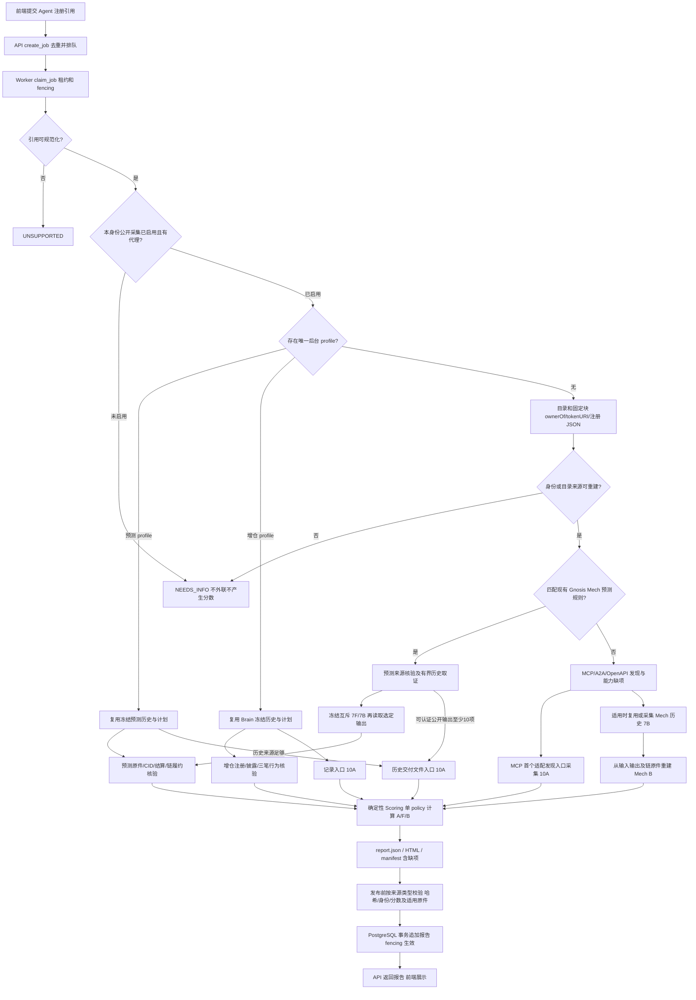

# Agent 评价机制架构审查

审查日期：2026-10-19。对象：当前本地 `web3-agent-reputation` 工作区；Git HEAD 为 `3a680f3c5c82b51d3cc0b6fd51eb32bbb1cc9b39`。当前实现包含既有未提交修改，本文以实际文件为准，不将 HEAD 当作全部受审代码。本文仅新增本文件，未修改业务代码、配置、测试、数据库或历史材料，未启动评价、调用模型、执行链上写入或提交 Git。

引用均为项目根目录下的真实路径，后缀为本次工作区的一基行号，并同时给出函数、类或数据字段。历史 `runtime/` 文件是本机保留证据，不保证其他检出环境包含它们。

状态口径：**已实现并验证**指存在实际调用及保留运行证据，或本次完成明确范围的离线复核；**已实现但未验证**指有代码，但缺少对应真实闭环证明；**仅有设计**指有文档意图而无对应运行链；**未实现**指现有接入路径没有该能力。测试中的合成样本不等于真实业务已经接通；无法确认处另标“证据不足”。

已先复用 `docs/runbooks/HISTORICAL_EVALUATION_AND_AGENT2290_20261019.md:11` 的历史清单及 `docs/architecture/GENERALIZABILITY_REVIEW.md:15` 的业务边界，再核对现代码。本次只读执行了十份公开报告的 `_validated_report()` 分数重算、报告及 manifest 与发布索引的 SHA256 比较；对 2290 另校验 manifest 的 88 项输入哈希，并调用 `verify_generic_report_sources()` 复核，均通过。未重跑十份报告全部链语义、未访问数据库、未重做历史评价。既有“14,696 个依赖哈希一致”来自 `runtime/agent2290-audit-20261019/offline-check-results.json:4` 的历史检查，本次没有重复该全量检查。

## 1. 审查结论摘要

1. **当前是“共享平台底座 + 固定政策/业务分支”，尚不是能力 Checker 可注册的统一 Judge Engine。** 提交、租约、身份表示、证据清单、样本、评分和报告已统一；实际业务选择仍由 Worker 的 profile/policy 分支、预测专项优先分支、协议发现和 Mech 历史分支组成。依据：`services/platform/src/reputation_platform/worker.py:182`，`evaluate()`；`services/platform/src/reputation_platform/generic_evaluation.py:176`，`evaluate_generic()`；`packages/core/src/reputation_core/planning.py:29`，`PlanSelection`。
2. **完整评分已得到真实历史验证，但业务覆盖集中。** 十个完整对象是九个 Gnosis Mech/Omen 历史预测和一个 Brain/BSC 增仓特例；并未证明任意 MCP/A2A Agent 或九个独立提供方都可评价。来源是过去真实履约与当时公开读取，未为这些分数新建预测或增仓任务。依据：`data/public-reports-v1.json:13` 的发布清单；`docs/runbooks/HISTORICAL_EVALUATION_AND_AGENT2290_20261019.md:26`、`:32`、`:52`。
3. **通用发现、可复核留证和缺项处理已经可复用，通用业务正确性尚未接通。** MCP 可发现工具并评价发现接口 A；A2A/OpenAPI 可读取声明；通用 Mech 分支可跨工具核验同协议历史 B。但通用来源校验器只接受受支持的 A 和已重建的 Mech B，不接受任意 F。依据：`services/platform/src/reputation_platform/protocol_evaluation.py:164`，`collect_protocol_evaluation()`；`services/platform/src/reputation_platform/generic_evaluation.py:70`，`verify_generic_report_sources()`；`services/platform/src/reputation_platform/mech_task_evidence.py:161`，`_samples()`。
4. **2290 的 PARTIAL 是业务证据缺口的真实表达。** 它取得注册读取和 MCP 发现接口的十个 A 样本，但没有编排/路由任务及独立预期结果，也没有适用的非交易履约 B。注册 JSON 获取超时和当前 Worker public-off 是另两层问题；修复其中任一层都不会自动补齐 F/B。依据：`runtime/generic-evaluation-20261019T093532Z-805ea72f/report.json:540`；下文第 5 节。
5. **主要扩展瓶颈是“按能力建立可归属任务、独立判据及行为语义”，其次才是调度接口。** 可以逐步统一现有调度、复用确定性核验函数；不能把 LLM、工具 Schema、接口返回 200 或交易成功当作通用业务通过。不同政策的 A/F/B 虽同权重，实际测量语义也不完全相同。依据：`packages/core/src/reputation_core/scoring.py:85`，`_dimension_score()`；`services/platform/src/reputation_platform/model_analysis.py:39`，`INSTRUCTIONS`；`packages/core/src/reputation_core/prediction_chain.py:360`，`verify_prediction_chain()`。

| 能力 | 当前状态 | 结论边界 |
| --- | --- | --- |
| 提交/排队/租约/报告存储、固定规则评分 | 已实现并验证 | 不代表自动产生足量业务证据 |
| 注册读取、MCP 发现与 A | 已实现并验证 | 2290 提供真实案例；只覆盖所适配传输和入口 |
| Mech/Omen 预测 A/F/B、Brain 增仓 A/F/B | 已实现并验证 | 对应冻结历史和特定协议/业务 |
| 通用 Mech 跨工具历史履约 B | 已实现但本次未验证；有历史通过记录 | 同一 Mech 协议的复用，相关旧运行原件未在本机恢复包，不是任意业务答案核验 |
| `service-contract-v1` 接受绑定能力的 F/B 数据结构 | 已实现但未验证为通用业务闭环 | 合成测试可算分；上游通用 F 未接入 |
| 任意 MCP/A2A 业务自动测试、非交易通用 B | 未实现 | 静态候选探针是例外，未接正式评分 |
| 能力 Checker 注册、多专项合成 Judge | 仅有设计方向，运行机制未实现 | 已有逐能力字段，尚无统一注册/组合策略 |

## 2. 当前系统架构

### 2.1 核心模块及实际职责

当前部署形态是 Vue 前端、FastAPI API、独立 Python Worker 与 PostgreSQL；业务核验由同仓 Python 包和脚本完成，未发现独立 Judge 服务。模块边界如下。

| 目录/入口 | 实际职责与连接证据 |
| --- | --- |
| `apps/web/src/` | `apps/web/src/App.vue:206` 的 `submit()` 调 `apps/web/src/api.ts:30` 的 `submitEvaluation()`；`apps/web/src/App.vue:124` 轮询作业，完成后导航报告。前端展示，不选业务政策、不生成分数 |
| `services/platform/src/reputation_platform/api.py:18` | `create_app()` 提供 Agent/报告/证据/作业 API；`:62` 的 `submit_evaluation()` 调 `Repository.create_job()` |
| `services/platform/src/reputation_platform/worker.py:182` | `evaluate()` 规范化身份、控制公开采集、匹配后台 profile、选择既有评价路径；`:29` 的 `execute_child()` 调专项脚本并续租 |
| `registration_discovery.py`、`protocol_evaluation.py`（同上平台目录） | 前者 `discover_registration():255` 取得目录、链注册、注册 JSON；后者 `collect_protocol_evaluation():164` 发现接口、列能力和采集 MCP A |
| 平台包内 `prediction_auto*.py`、`prediction_evidence.py`、`prediction_report.py` | 自动识别已有预测方案、采集/复用历史、冻结选择、从原件重建结果、生成预测报告；入口 `services/platform/src/reputation_platform/prediction_auto.py:169` 的 `evaluate_auto_prediction()` |
| `scripts/collect_liquidity_history.py:59`、`scripts/build_liquidity_report.py:494` | Brain 增仓历史采集与报告；后者 `main()` 依赖固定 pilot 配置和已保留历史/RPC/选案 |
| `packages/core/src/reputation_core/` | `packages/core/src/reputation_core/planning.py:40`/`:149` 固定政策匹配；`packages/core/src/reputation_core/liquidity.py:51`、`packages/core/src/reputation_core/disclosure.py:63`、`packages/core/src/reputation_core/behavior.py:272`、`packages/core/src/reputation_core/prediction.py:8` 提供确定性规则；`packages/core/src/reputation_core/scoring.py:117` 统一算分；`packages/core/src/reputation_core/reporting.py:49` 统一报告模型 |
| `services/platform/src/reputation_platform/db.py:124` | `Repository._load_report()` 校验导入证据；`:376` 的 `finalize_job()` 将核验后的报告按身份/租约发布；API 从库读取 |
| `configs/`、`runtime/`、`data/`、`docs/adr/`、`reference/` | 分别保留有限链/RPC与pilot配置、原始运行证据/报告、发布索引、政策决策、候选与离线研究；文档/研究不会自动变成 Worker 能力 |

表中平台目录内的简写文件均位于 `services/platform/src/reputation_platform/`；后文关键判断使用完整路径。

### 2.2 实际完整流程

图中“未启用”是正常 public-off 分支；启用却缺代理、重复 profile、证据处理异常等会进入平台失败处理，不能扣 Agent 分。证据：`services/platform/src/reputation_platform/worker.py:189`、`:200`、`:208`、`:264`，`evaluate()`/`main()`。

### 2.3 调用关系与真实接入状态

- **统一入口真实存在。** `packages/core/src/reputation_core/application.py:14` 的 `normalize_reference()` 支持 canonical 标识及限定格式的 8004scan URL；`services/platform/src/reputation_platform/db.py:297` 的 `create_job()` 去重，`:319` 的 `claim_job()` 用 `SKIP LOCKED`、租约和 fencing。它们统一的是任务生命周期，不是业务判据。
- **没有 profile 的新对象走通用路径。** `services/platform/src/reputation_platform/worker.py:evaluate():188` 先按完整身份找 profile；未匹配且允许采集时才调用 `services/platform/src/reputation_platform/generic_evaluation.py:evaluate_generic():176`。后者先 `discover_registration()`/`verify_registration_proof()`，再尝试预测专项；预测分支返回 True 就直接结束，未执行通用协议分支，见该文件 `:196`、`:210`、`:214`。
- **报告状态与作业状态不同。** 通用/自动预测作业完成发布时可标 `COMPLETE`，而报告仍是 `PARTIAL`；完整性由 `packages/core/src/reputation_core/scoring.py:145` 根据三维证据决定。发布调用见 `services/platform/src/reputation_platform/generic_evaluation.py:273`、`services/platform/src/reputation_platform/prediction_auto.py:305`。2290 的作业完成不代表三维完整。
- **代码存在不等于当前启用。** `services/platform/src/reputation_platform/worker.py:239` 的 `--enable-public-readonly` 默认关闭，`:240` 可限单身份。本次只读查看运行命令，常驻 Worker 无开启参数；默认 `runtime/platform-config/profiles.json` 不存在，`:248` 会读为空列表。既有记录也表明 scoped `--once` 完成后仍是 public-off：`runtime/agent2290-audit-20261019/final-worker-state.json:20`。未证明当前本机可不经运维启用就自动评价新身份。

## 3. 现有评价类型与覆盖范围

### 3.1 已接入方案矩阵

| 路径/政策 | 任务与正确性判据 | 原始证据及维度 | 自动化与限制 |
| --- | --- | --- | --- |
| 通用发现 / `service-contract-v1` | MCP `initialize`、初始化通知、`tools/list`；校验版本、JSON-RPC ID、工具结构。A2A Card/JSON、OpenAPI paths 仅读声明 | 请求计划、HTTP 原文、观测、协议初始化绑定；可得 MCP 发现 A，不能因此给 F/B | 新注册可自动发现；仅首个 ready MCP 入口安排 10A；非兼容会话/SSE、分页等保留缺项。`services/platform/src/reputation_platform/protocol_evaluation.py:164`、`:232`、`:272` |
| 通用 Mech 历史履约 / `service-contract-v1` | 选取可归属普通请求，核 request/deliver、原输入输出、tool、prompt、CID、服务控制和支付/时序 | 公开历史和 RPC/IPFS 原件；可得 B，答案业务正确性未判 | 仅 Gnosis/既有注册桥/Mech 协议；先复用本地 bundle，否则有界采集；不是非交易 B。`services/platform/src/reputation_platform/mech_task_collection.py:139`；`services/platform/src/reputation_platform/mech_task_evidence.py:161`、`:224` |
| `prediction-history-v1` / `prediction-history-v2` | 14 个不同已结算 Omen 市场，7F 概率信用、另 7B 交付履约；另做 10 次历史文件入口访问 A | 原问题/输入输出、CAR/CID、Omen/Reality/ConditionalTokens 结算、请求交付/执行控制/付款原件 | 同协议新身份可自动附加，无需逐对象评分代码；限支持的来源、Fixed Price Native、I/O 与历史格式；不足保留部分报告。`services/platform/src/reputation_platform/prediction_auto.py:169`；`services/platform/src/reputation_platform/prediction_evidence.py:451`；`services/platform/src/reputation_platform/prediction_report.py:596` |
| `liquidity-history-v1` | Brain 已公布增仓历史：7F 核披露金额/流动性，另 7B 核包装、兑换、增仓；10A 测记录入口 | 注册事件/文档、历史 JSON、BSC tx/receipt/header、NPM 固定状态与同块事件 | 已验证完整特例；Worker 依赖后台 profile/历史目录，采集器绑定 Brain 记录结构、对象和冻结索引。`scripts/build_liquidity_report.py:376`；`configs/pilots/brain-defi-liquidity-v1.json:1` |
| 静态候选/免费接口探针 | 人工审核的固定 URL、请求参数及少量模拟操作；例如 Clicks `tools/call clicks_simulate_split`、Brain look | 只能证明候选可行性/接口观察；非正式 F/B，不能填综合分 | CLI 未接通用 Worker。`services/platform/src/reputation_platform/public_targets.py:7`、`:79`；`scripts/check_candidates.py:17`、`:36` |

矩阵前两行的 `protocol_evaluation.py`、`mech_task_collection.py`、`mech_task_evidence.py` 与预测模块均在 `services/platform/src/reputation_platform/`。`service-contract-v1` 的“contract”是服务声明/履约证据政策，**没有实现对任意智能合约的审计或正确性证明**；实际允许的样本见 `services/platform/src/reputation_platform/generic_evaluation.py:38`、`:70` 的 `verify_generic_report_sources()`。

### 3.2 预测与增仓任务如何确定

**预测：不生成新预测任务，以真实历史请求为测试输入。** `services/platform/src/reputation_platform/prediction_evidence.py:451` 的 `collect_history()` 先从有界历史线索校验原始输入 CID、实际 tool、问题/市场、结算和时序；资格循环达到 14 个市场即停止。`:569` 规定选样不依赖输出，`:575` 分配互斥 7F/7B，`:590` 先持久化计划，`:593` 后读取选定输出。自动路径默认 cutoff 为 2026-10-01 UTC、v2 最多检查 512 条历史，见 `services/platform/src/reputation_platform/prediction_auto_sources.py:156` 的 profile 构造。不能理解成扫描全部业务或未来在线基准。

F 的外部预期来自已结算市场的二元结果，而不是人工为每题填“答案”或让模型判断真伪。`packages/core/src/reputation_core/prediction_chain.py:136` 的 `verify_omen_settlement()` 重建问题、选项、Reality 问题、条件及最终 payout；这证明**协议结算结果**，没有独立调查现实事件是否被市场正确裁决。输入题干、原 requestId 与输出的绑定由 `services/platform/src/reputation_platform/prediction_report.py:361` 的 `explain_task()` 完成。

**增仓：使用特定公开记录格式和冻结选样。** `configs/pilots/brain-defi-liquidity-v1.json:1` 绑定链 56、Agent #363709、执行钱包、历史 URL/SHA；F 索引 `[97,99,101,104,112,116,121]`，B 索引 `[98,100,102,106,114,119,123]`，另有 13 条不宣称动作的背景记录。`scripts/collect_liquidity_history.py:59` 的 `prepare()` 读取 `history[].steps.increase` 及固定交易标签，由该文件 `:306` 的 `main()` 调用；不是给任意 DeFi Agent 自动构造任务。历史索引 123 曾用于可行性核验，不能将整批称为盲测，见既有复核 `docs/runbooks/HISTORICAL_EVALUATION_AND_AGENT2290_20261019.md:54`。

增仓 F 由 `packages/core/src/reputation_core/disclosure.py:63` 的 `verify_disclosure()` 用固定前后状态和完整同块事件定位目标交易后的仓位状态，比较披露值；B 由 `packages/core/src/reputation_core/behavior.py:272` 的 `verify_behavior()` 校验三笔交易的身份、参数、金额、顺序、时间及确认。它不验证投资策略最优、收益或所有资金风险。

### 3.3 十个完整对象及证据类型

以下为当前发布版本，均以 `data/public-reports-v1.json` 相应项目的完整身份、报告目录、哈希为索引；本次重算一致。分数只代表各自政策/样本范围。

| 链 / Agent | 路径与政策 | A / F / B / 综合 | 发布索引行 |
| --- | --- | --- | ---: |
| Gnosis / 2135 | 自动预测 v2 | 97.05 / 72.89 / 100 / 88.27 | 13 |
| Gnosis / 2182 | 自动预测 v1（复用既有历史） | 98.33 / 77.64 / 100 / 90.56 | 58 |
| Gnosis / 2198 | 早期后台选案/profile，预测 v1 | 98.20 / 75.66 / 100 / 89.72 | 103 |
| Gnosis / 2235 | 早期后台选案/profile，预测 v1 | 98.61 / 97.81 / 100 / 98.71 | 148 |
| Gnosis / 2267 | 自动预测 v2 | 99.34 / 0 / 0 / 29.80 | 193 |
| Gnosis / 2340 | 自动预测 v1，含勘误 | 98.51 / 79.33 / 100 / 91.28 | 238 |
| Gnosis / 2359 | 自动预测 v2 | 89.79 / 68.62 / 100 / 84.39 | 283 |
| Gnosis / 2360 | 自动预测 v1 | 98.33 / 72.79 / 100 / 88.62 | 328 |
| Gnosis / 4110 | 自动预测 v1，补登记时点证据 | 89.69 / 53.89 / 100 / 78.46 | 373 |
| BSC / 363709 | Brain 增仓特例 v1 | 93.09 / 100 / 100 / 97.93 | 418 |

实际入口/演进来源：`docs/runbooks/HISTORICAL_EVALUATION_AND_AGENT2290_20261019.md:30`、`:32`；逐对象任务、Mech、service、原件目录在 `runtime/agent2290-audit-20261019/historical-evidence-inventory.json:1`。九个 Gnosis 身份是同生态复用的证据，不是跨独立生态覆盖证明；全部最初人工搜索与失败探索不在本机恢复包，相关细节证据不足。

| 路径 | 真实业务执行 | 平台历史复核 | 当时接口采样 | Mock/离线部分 |
| --- | --- | --- | --- | --- |
| 九个预测 | Agent 过去执行请求/交付；本次及既有报告生成未新建付费任务 | F/B 的主要证据，14 个互斥历史任务 | 10 槽公开交付文件读取，测文件入口而非实时推理 | 单元/变异测试辅助；报告可离线重建，不把 Mock 当真实交易 |
| Brain 增仓 | Agent 过去执行三步交易；评价未主动增仓 | 7F/7B 的主要证据 | 10 槽记录入口 JSON 读取 | 固定原件重建、fixture 变异测试；不是实时策略回测 |
| 通用 Mech B | 过去真实请求/交付 | 公开任务/CID/链原件 | 只有另有适配 MCP 才有通用 A | 离线核验原件，不证明工具答案正确 |
| 2290 | 无业务工具调用、无新交易 | 没有编排业务历史被接入评分 | MCP 发现与 10A，另读 A2A/注册等 | 本次离线复核已留存请求；非 Mock A |

2267 的 F/B 为 0 是认证后的输出违约，不能改称“七次交易均失败”；2360 有一个 A UNKNOWN，另外九项确定，仍满足 A 门槛。2340 的旧 83.01 已被可追溯勘误到 91.28；2135 历史事件格式、4110 登记日期也有修订，不能引用旧缺项当作当前事实。依据：`docs/runbooks/HISTORICAL_EVALUATION_AND_AGENT2290_20261019.md:89`、`:91`。

旧 `docs/architecture/GENERALIZABILITY_REVIEW.md:9` 中“2340仅B、无综合分”是通用履约阶段的历史快照；当前完整预测版本应以发布索引 `data/public-reports-v1.json:238` 为准。旧文档描述的提供方域名约束也必须区分旧采集入口与后续自动入口，不能覆盖当前代码事实。

静态 Clicks 探针需单列：历史文档记录 `tools/call` 返回 HTTP 200 但 `result.isError=true`，受上游用量限制，未得到模拟分账结果，判 UNKNOWN/background；见 `reference/CANDIDATE_EXPANSION_20261018.md:63`。本机未找到该次 `candidate-check` 原响应，故只认可其为历史记录，不宣称本次独立验证了工具执行。Brain look 的独立状态对照也未形成完整 F，见 `scripts/build_admission_report.py:284`。

通用 Mech B 也要区分证据层次：`docs/runbooks/LOCAL_PLATFORM.md:100` 记录2198/2235原七个B槽跨2/3种工具、合计4种，离线重派生通过；`:104` 记录2340独立B报告七PASS、100分、综合null。相关旧运行目录不在本机恢复包，本次只确认代码调用链，未重验这些通用报告原件。ADR-0011曾把工具数写成2/4，`docs/adr/0012-resume-frozen-task-evidence.md:9` 已明确勘误为2/3，不能将旧计数当新增覆盖。

## 4. 当前 Judge / Planner / Adapter / Verifier / Scoring 机制

### 4.1 调度与身份：有统一生命周期，没有统一业务 Judge

`services/platform/src/reputation_platform/worker.py:evaluate():182` 是作业调度入口；`services/platform/src/reputation_platform/generic_evaluation.py:evaluate_generic():176` 是无 profile 的统一接入编排入口。二者共同起到一部分 Judge 外壳作用，但政策选择、取证、验证及报告组装仍分散在专项函数/CLI 中，没有 Checker 注册表、统一业务执行契约或任意能力的判据选择器。

身份链分成三个层次，不能合并解释：

1. **输入规范化。** `packages/core/src/reputation_core/application.py:14` 的 `normalize_reference()` 可解析 canonical 中的数字链号；8004scan URL 使用限定链名映射和固定注册合约，拒绝 query/fragment。解析成功不等于有该链 RPC 或业务支持。
2. **链上注册读取。** `services/platform/src/reputation_platform/registration_discovery.py:46` 的 `_configuration()` 当前仅配置 100/56/8453；`discover_registration():255` 核目录身份、固定 head−64 区块的 `ownerOf()`/`tokenURI()`。`:305` 的 `registration_verified` 只要求 owner/URI 成功，**不等于注册 JSON 已取得，更不是 Agent 业务认证**。
3. **端点/声明来源。** 同文件 `_uri():87` 支持 data JSON、HTTPS 和固定 IPFS 网关；`:321` 检查 JSON，`:331` 允许目录缓存回退并标 `services_source=directory-unverified`。`:326` 明示通用注册模块没有 CID/DAG 内容认证；不能拿预测 CAR 的认证能力替代这一缺口。`verify_registration_proof():350` 会从原始请求/响应/RPC 重建各层事实，而非信任 summary 的布尔值。

能力提取主要是 `_services():210` 等别名归一、声明字段收集和协议文档枚举；未发现将任意 operation 自动归入“查询/监测/规划/编排”等运行时 taxonomy 的机制。`reference/CAPABILITY_COVERAGE_DECISION_20261018.md:14` 的动作簇是离线研究，`:59` 也承认多专项组合和通用 F 未实现。

### 4.2 Planner：选择已有政策，不是生成任意测试

| 选择器 | 实际规则 | 作用边界 |
| --- | --- | --- |
| `packages/core/src/reputation_core/planning.py:40` `select_plan()` | 来源声明、钱包/manager、链 56、`pancakeswap-v3-npm`、`run-history-increase-v1` 等 | 只匹配已存在的增仓历史方案；上层 CLI 仍读 Brain 特定原件，见 `scripts/select_evaluation_plan.py:79` |
| 同文件 `:135` `_prediction_meaning()`、`:141` `prediction_tool_supported()` | 英文 description 中 prediction/forecast 与 binary/market/Omen 语义词，且真实 I/O 为 text→object/result-string，含 requestId/prompt/result 和概率示例字段 | 比名称匹配可靠，但仍是固定语义词/Schema 规则；并非通用语义分类器，也不保证输出真的正确 |
| 同文件 `:149` `select_prediction_plan()` | 链 100、Olas Mech、IPFS 格式、Omen 历史上下文、引用声明、实际历史 tool/prompt/market；v2 支持限定 `Will ...?` 原题形式 | 产生 SELECTED/NEEDS_INFO/UNSUPPORTED；不替代历史归属、结算、CID和样本充分性验证 |
| `services/platform/src/reputation_platform/prediction_auto_selection.py:59` `write_auto_selection()` | 从已认证 catalog 和原始输入确定性构造带出处的声明/descriptor，再调上述 selector | 后期自动预测选案不调用 LLM，`:179` manifest 为 model_calls=0 |

`PlanSelection.policy_id` 只有固定几种 Literal，见 `packages/core/src/reputation_core/planning.py:29`；没有按能力注册新模板的运行机制。上层自动来源准备仍要求固定 Gnosis registry/BRIDGER、Olas tokenURI、service/Mech 链上绑定、支持 factory，见 `services/platform/src/reputation_platform/prediction_auto_sources.py:122` 的 `prepare_prediction_source()`。旧 `services/platform/src/reputation_platform/prediction_evidence.py:301` 的 `collect_identity()` 还有 Valory operator 域名约束；新自动入口可从官方目录的唯一 service/Mech 线索回退后核桥/getter，见 `services/platform/src/reputation_platform/prediction_auto_sources.py:146`、`:167`。因此“所有预测仍强制某 operator 域名”的旧结论已不完全适用，但“支持任意预测协议”同样不成立。

### 4.3 Adapter / 执行器：协议读取和业务履约是两层

- `services/platform/src/reputation_platform/protocol_evaluation.py:23` 的 `descriptor_remote()` 适配限定 MCP JSON descriptor 的唯一 streamable-http remote；`collect_protocol_evaluation():204` 执行初始化、通知、工具列表。它不执行任意工具；`:235` 的 A2A/OpenAPI 分支仅 GET JSON 文档，不创建 A2A task，也不执行列出的 HTTP 业务方法。OASF/未支持服务保留 UNKNOWN。
- `services/platform/src/reputation_platform/prediction_evidence.py:451` 的 `collect_history()`、`services/platform/src/reputation_platform/mech_task_collection.py:139` 的 `_collect_mech_history()` 是历史业务协议适配器；后者限定同生态、最多查 32 条候选并冻结普通任务七槽，见 `services/platform/src/reputation_platform/mech_task_collection.py:194`。两者均不提交新 Mech 任务。
- `scripts/collect_liquidity_history.py:59` 和 `scripts/build_liquidity_report.py:494` 承担增仓适配及报告编排，既有 Worker 只刷新 A 并复核 profile 指向的历史，不会从任意新钱包自动生成增仓计划，见 `services/platform/src/reputation_platform/worker.py:215`。
- `services/platform/src/reputation_platform/public_targets.py:79` 的静态 `tools/call` 说明仓库有受人工限定的探针能力；`scripts/check_candidates.py:17` 未被 `evaluate_generic()` 调用，且用途为 candidate-feasibility-only。应区分“有探针代码”“曾做候选接口探索”“通用业务已评分”三个状态。

### 4.4 Verifier：确定性函数与原件重建，不是 LLM Judge

| 核验层 | 实际实现 | 独立性与不覆盖内容 |
| --- | --- | --- |
| 注册/协议来源 | `services/platform/src/reputation_platform/registration_discovery.py:350` `verify_registration_proof()`；`services/platform/src/reputation_platform/generic_evaluation.py:21` `verify_generic_report_sources()` | 重建目录身份、RPC/URI/HTTP、初始化/请求计划/顺序/响应；注册声明不是正确性答案 |
| 预测原件认证 | `services/platform/src/reputation_platform/prediction_report.py:34` `RetainedEvidence`，尤其 `:118` 的 `content()`/`:121` 的 `content_bytes()` | 哈希、保留RPC封装、输入输出CID/CAR/DAG内容绑定；不是仅信“文件里写了PASS” |
| 预测结算/履约 | `packages/core/src/reputation_core/prediction_chain.py:136` `verify_omen_settlement()`、`:333` `extract_task_anchors()`、`:360` `verify_prediction_chain()` | 将问题、结果、请求交付、CID、历史 service/operator/Safe、接手超时、付款 cap 与调用事件绑定；不适配的 signed/offchain 路径 UNKNOWN，不保证现实真相或所有未来行为 |
| 预测样本判定 | `services/platform/src/reputation_platform/prediction_report.py:361` `explain_task()` | F 检概率/问题/结算，B 检交付及其约定内容；已认证输出违约 FAIL，取不到必要证据 UNKNOWN。F 不要求所有 B 专属检查先 PASS |
| 增仓动作/披露 | `packages/core/src/reputation_core/liquidity.py:51` `verify_increase()`；`packages/core/src/reputation_core/disclosure.py:63` `verify_disclosure()`；`packages/core/src/reputation_core/behavior.py:272` `verify_behavior()` | 前两者部分参数化；行为模块限定 WBNB/CAKE、router/manager、fee 和三步流程。只认可有执行归属的动作，不拿接收钱包当执行者 |
| 通用 Mech B | `services/platform/src/reputation_platform/mech_task_evidence.py:161` `_samples()`、`:275` `verify_mech_task_samples()` | 复用履约/CID/输入输出绑定，能跨 tool；不能由交付推导业务答案正确 |

“独立”主要指**独立于 Agent 自报结果的确定性重算和外部协议状态对照**。数据仍依赖所配置 RPC、保留历史、网关和目录；没有证据表明这里实现了多提供方共识审计或链轻客户端证明。当前可信度和覆盖范围应逐来源说明，不能把模型赞同或 bundle 中自报字段当独立判据。

### 4.5 LLM 与人工输入的权限

`services/platform/src/reputation_platform/model_analysis.py:39` 的 `INSTRUCTIONS` 要求提取可检验声明，不评分、不执行，输入文档不可信、必须给严格连续引文并保留费用限制。`declaration_target():80`/`parse_declarations():86` 使用结构化输出；`packages/core/src/reputation_core/claims.py:47` 的 `validate_analysis()` 检查 Schema/引文/来源关联，**不证明模型对业务含义的解释正确**。早期语义复核由离线流程完成，见 `docs/runbooks/MODEL_EVIDENCE_LOOP.md:17`；这不是每个网站提交都运行的统一 Verifier。

| 判断/用途 | 当前由谁完成 | 是否能决定业务通过/分数 |
| --- | --- | --- |
| 声明操作、输入输出、限制及原文引用 | 早期 LLM 提取 + 程序引用校验 + 离线语义复核 | 仅形成候选事实和选案输入，不能直接评分 |
| 后期预测匹配、资格/14槽计划 | catalog/原输入 + 固定 selector/采集规则 | 可选择已有政策；不能替代独立原件核验 |
| 原输入输出、交易履约、结算、概率合法性 | 上述确定性 Verifier | 产生有范围的 PASS/FAIL/UNKNOWN/N_A |
| 中文预测题翻译 | `services/platform/src/reputation_platform/question_translation.py:225` 的 `TRANSLATION_INSTRUCTIONS`、`:235` 的 `translation_target()` | 只传题目及摘要，不传概率、结算方向和分数；仅报告展示 |
| A/F/B 及综合分 | `packages/core/src/reputation_core/scoring.py:117` 的 `calculate_scores()` | 固定政策重算，LLM无改权重或补缺项权限 |

历史报告的模型主要为 `deepseek-flash`；当前 `gpt-6-luna` 连通配置不表示参与这些历史评分。早期部分声明模型原始请求/响应未在恢复包，不能完整重证总调用数/费用；见 `docs/runbooks/HISTORICAL_EVALUATION_AND_AGENT2290_20261019.md:60`、`:62`、`:66`。自动预测 READY/14题分支会调用翻译脚本 `--execute`，可能产生模型费用，见 `services/platform/src/reputation_platform/prediction_auto.py:271`；因此“公开只读 Agent”不等于整条流水线永远无任何模型费用。本次未执行该路径。

### 4.6 A/F/B 的实际算分与跨业务语义

规则入口是 `packages/core/src/reputation_core/scoring.py:117` 的 `calculate_scores()`；常量在 `:11`，逐维计算在 `:85`。报告模型 `packages/core/src/reputation_core/reporting.py:90` 的 `scores` 是计算字段，不由前端或模型赋值。

| 项目 | 现规则与证据要求 |
| --- | --- |
| 样本规模 | A 必须恰好保留 10 槽且 PASS+FAIL≥8；F/B 各恰好 7 槽且全部确定。并非任意多采几条即可算分 |
| 四态 | PASS/FAIL 进入确定分母；UNKNOWN/N_A 不当失败或通过，但不足会使该维为 null。零分是确定失败，null 是未得出分数。background 不允许进入评分 |
| A | `80×PASS/(PASS+FAIL)+20×L`；成功请求 p95 用 nearest-rank；`L=clamp((10000-p95)/9000,0,1)`。仅成功样本计延迟，≥10000ms 延迟项为0，≤1000ms为满分 |
| 增仓 F、各已适配 B | 充分时为 `100×PASS/(PASS+FAIL)`；但 PASS 的含义由具体核验规则决定 |
| 预测 F | 合法二元概率的单题信用为 `100×(1-(p_yes-y)^2)`，七题平均；无合法概率的已认证违约可为 FAIL/0。不是方向准确率，50/50 可得75信用分 |
| 互斥与总分 | sample_id/task_key 全局唯一，同一任务不能进入两个分母；三维都非null才算 `0.30A+0.40F+0.30B`，不重分配缺项权重。否则有样本为PARTIAL、无样本为NOT_EVALUATED |

概率合法性与方向判定分别见 `packages/core/src/reputation_core/prediction.py:8` 的 `BinaryPrediction`（有限、[0,1]、概率和误差）和 `packages/core/src/reputation_core/scoring.py:50` 的 `ScoredSample.validate_prediction()`（最终结果概率≥0.5对应方向PASS）。不能把方向FAIL直接解释为该题信用一定为0。

**同一 A/F/B 名称不等于相同测量语义。** 预测 A 访问历史交付文件，Brain A 访问记录 JSON，通用 A 访问 MCP 工具发现接口；均不是实时业务成功率。证据：`services/platform/src/reputation_platform/prediction_auto.py:260`，`scripts/sample_availability.py:31`，`services/platform/src/reputation_platform/protocol_evaluation.py:120`。预测 F 是概率信用，增仓 F 是披露精确一致率；跨政策综合分不能脱离 scope 当作完全可比的统一能力分。

通用 MCP A 会把 5xx、HTTP200但 ID/tools 结构错误判 FAIL；授权/付费/限流、SSE、传输异常及未适配状态保留 UNKNOWN，见 `services/platform/src/reputation_platform/protocol_evaluation.py:78` 的 `availability_verdict()`。这里有意不把平台网络条件或访问许可不明直接当业务失败。

### 4.7 证据、报告冻结、数据库及验证边界

取证端先保存精确请求计划，再保留观测和原响应，见 `services/platform/src/reputation_platform/registration_discovery.py:128` 的 `DiscoveryEvidence.request()`；安全传输的 PASS 只表示传输观测，不是业务判定。`services/platform/src/reputation_platform/safe_http.py:218` 的 `SafeHttpClient.fetch()` 还有响应大小/预算/秘密隔离；`services/platform/src/reputation_platform/pinned_http.py:28` 的 DNS 固定与私网拒绝用于限制不可信端点。通用固定代理支持边界不能由 LLM/ZAN 客户端能力推定。

`services/platform/src/reputation_platform/registration_discovery.py:19` 的 RPC 方法白名单与 `DiscoveryEvidence.request():128` 限制外部请求类型、允许的header，并拒绝metadata自带RPC；401/402/403/429触发主机停止。`services/platform/src/reputation_platform/safe_http.py:151` 禁止自动重定向；`services/platform/src/reputation_platform/pinned_http.py:28` 仅在显式代理及全部Fake-IP等限定条件下用DoH，仍拒绝私网/混合解析。它们是实际安全边界；“遇到鉴权就自动换凭据/付费继续”未实现，也不属于自动回退。

报告的来源、任务与能力关联已有约束：`packages/core/src/reputation_core/reporting.py:23` 的 `CapabilityCoverage`、`:36` 的 `SampleExplanation`、`:68` 的 `bind_service_contract_capabilities()` 要求 service policy 的 F/B 绑定对应 capability/sample；但这只保证关联结构，不能自动产生业务判据。

持久化有以下分层，不能概括为“每次读报告都全量链复核”：

1. `services/platform/src/reputation_platform/db.py:49` 的 `_validated_report()` 从 samples 重算分数并比较；`:85` 的 `_manifest()` 检文件清单与哈希。
2. `Repository._load_report():124` 对 service policy 调来源重建，对有 `prediction-auto-origin.json` 的报告调用 `services/platform/src/reputation_platform/prediction_auto.py:100` 的 `verify_auto_prediction_report()` 重建整个预测报告并比较；**旧 pilot 分支**在 `services/platform/src/reputation_platform/db.py:140` 主要校验 manifest、pilot身份及分数，没有在此全面重跑增仓/预测链语义。专项构建器的核验与导入器保障范围不同。
3. `Repository.finalize_job():376` 发布前复核、绑定身份及创建时序，并用 fencing 事务提交；`services/platform/src/reputation_platform/schema.sql:55` 控制活动作业去重，`:60` 的触发器限制报告/候选历史修改；`get_report():267` 读取已验证 JSON 并重算分数，附件接口 `evidence_file():272` 限白名单和 SHA。不能据此声称磁盘原件不可被管理员改写或每次读取都重新验证全部链状态。

评分函数本身无 I/O，已有解耦；但专项 `explain_task()`/`task_explanation()` 仍同时构造检查项、样本判定及报告解释，采集/核验/展示并未全部通过统一接口分离。当前独立业务判据主要是上述可调用函数，而不是单独部署的 Verifier 进程。

测试支持的范围也应分开：`tests/test_generic_scoring.py:15` 是合成 F/B 与能力绑定测试，不是通用业务闭环；`tests/test_behavior.py:16`、`tests/test_disclosure.py:15` 等覆盖保留fixture及变异；`tests/test_prediction_evidence_v2.py:19` 等部分用例依赖原件、可 skip；`tests/test_worker_scope.py:12` 使用 Mock 验证权限范围。`tests/test_local_platform.py:51` 会初始化/导入专用 PostgreSQL，故本次未运行。CI 主要执行评分边界测试、前端构建和隔离 public-off smoke，见 `.github/workflows/ci.yml:35`、`:68`，不能把 CI 通过当作所有 Checker 已验证。本次未运行测试套件，以避免数据库、临时运行目录或外部副作用。

## 5. Agent 2290 无法完整评分的根因

### 5.1 实际走过的链路

对象是 `eip155:8453:0x8004a169fb4a3325136eb29fa0ceb6d2e539a432:2290`。已有单次 scoped public-readonly 作业完成；真实原件在 `runtime/generic-evaluation-20261019T093532Z-805ea72f/`，不是本次重跑结果。

1. `runtime/generic-evaluation-20261019T093532Z-805ea72f/intake-intent.json:3` 记录该身份、`service-contract-v1`、`business_calls=false`/不写链。
2. 读取 Base 固定块：head 52806597、snapshot 52806533，取得 ownerOf/tokenURI；`runtime/generic-evaluation-20261019T093532Z-805ea72f/registration-proof.json:850` 显示 URI 是 IPFS，`document=null`、`registration_verified=true`。注册读取成功与文档缺失同时成立。
3. 固定网关取文档超时，原观测 `runtime/generic-evaluation-20261019T093532Z-805ea72f/registration-document.observation.json:1` 为 `error_kind="TimeoutException"`、耗时19797ms，无响应正文。`runtime/generic-evaluation-20261019T093532Z-805ea72f/registration-summary.json:1117` 标 `services_source="directory-unverified"`；随后使用目录端点线索，未冒充已取得注册 JSON。
4. Base 在 `services/platform/src/reputation_platform/prediction_auto.py:175` 直接不匹配预测；`services/platform/src/reputation_platform/mech_task_evidence.py:224` 的通用 Mech 入口也不支持该身份的协议/链。没有适用增仓 profile，故只执行协议发现。
5. 报告列出 MCP `chat`、`route_task`、`get_agent_info`，以及 A2A Workflow Orchestration、Quality Validation、Agent Discovery；各能力 `sample_ids=[]`、范围为资料发现，见该 `runtime/generic-evaluation-20261019T093532Z-805ea72f/report.json:423`、`:442`、`:461`、`:480`、`:500`、`:520`。这些名称是对方声明，不是已验证业务成果。
6. `runtime/generic-evaluation-20261019T093532Z-805ea72f/report.json:540`：A=90.87、10PASS、p95=5109ms；F/B observed=0/value=null；综合null、PARTIAL。作业 `COMPLETE/DONE` 只表明本次处理和发布完成，见 `runtime/agent2290-audit-20261019/final-job.json:1`。

历史 manifest 的 `:370` 记录 22 次公开请求、0 模型调用、不写链；`runtime/agent2290-audit-20261019/result.json:40` 记录 0 tools/call、0交易。22次是目录1、RPC5、IPFS失败1、MCP发现3、A采样10、A2A1、Web1；不包含DNS辅助请求。**2290 的 A 是真实接口采样，F/B 是未测试，不是业务失败0分。**

本段省略目录的 `*.json` 路径均完整位于上列 `runtime/generic-evaluation-20261019T093532Z-805ea72f/`；本次对其88项输入及来源重建通过，未新增任何外部读取。

### 5.2 各层阻断及依赖

| 层次 | 触发条件/证据 | 实际后果 | 单独解决能否完整评分 |
| --- | --- | --- | --- |
| 输入 | `normalize_reference()` 拒绝带 query/fragment 的URL；历史带utm提交曾UNSUPPORTED，见既有手册 `:99` | 那个旧输入未进入取证；干净引用可解析 | 不能，只进入后续链路 |
| 当前运行环境 | `services/platform/src/reputation_platform/worker.py:190`/`:239` public-off；当前无开启参数，profile缺失 | 当前再提交未评身份通常NEEDS_INFO，不外联 | 不能；2290那次已在限定单次任务中跨过此门槛 |
| 网络/注册材料 | IPFS超时，注册JSON未取得；通用代理/DNS适配也是独立环境条件 | 端点只能当目录线索，缺注册文档绑定与部分声明证据 | 不能；成功取得JSON仍不是业务任务/正确性判据 |
| 政策匹配 | 自动预测限Gnosis/Mech/Omen；增仓需专用profile；Base路由能力不匹配 | 两种现有完整评分方案均不能套用 | 不能靠改ID或换链标签解决 |
| F业务任务 | `services/platform/src/reputation_platform/protocol_evaluation.py:169` 明示business_calls=false，`:179` 仅资料；未执行route_task、未有任务输入/预期路由/约束及输出证据 | 没有可供独立核验的七个F任务 | 这是独立的业务缺口，LLM理解工具说明不能补齐 |
| 来源复核接入 | `services/platform/src/reputation_platform/generic_evaluation.py:70` 的来源校验不接受任意通用F | 即使手工构造样本能被scorer算，也不能合法通过正式发布核验 | 必须有对应可重建业务证据，不能只改打分字段 |
| B非交易履约 | 当前B来自Mech交付或增仓交易；无编排任务的责任/完成/超时/授权等已接入判据 | B无样本；不能将“无交易”当B=100 | 独立于F是否可测，需要先明确该能力的B语义 |
| 评分门槛 | `packages/core/src/reputation_core/scoring.py:95`、`:146` 要求7F、7B和三维充分 | F/B及综合保留null | 门槛是证据不足的结果，不是应通过降门槛修复的根因 |

依赖关系是：**可用输入/运行许可 → 可取得并归属的资料 → 匹配适用任务与独立判据 → 足量F/B证据 → 来源复核 → 综合分**。当前网络/注册缺失与业务判据缺失并存；现有实现允许目录线索下形成有限 A，因此“拿不到IPFS就所有评价完全失败”和“只打开Worker就完整评分”均不符合实际。

换成另一个同类路由/编排 Agent，可复用身份发现、相同传输条件下 MCP 初始化/tools/list及A、A2A资料和缺项报告；不能自动复用尚不存在的编排 F/B。若只有 A2A Card、无已适配 MCP，当前甚至不会仅凭 Card 成功读取生成同样的十槽 A，依据 `services/platform/src/reputation_platform/protocol_evaluation.py:272`。

## 6. 架构通用性与扩展成本评估

### 6.1 可复用与绑定边界

| 已有逻辑 | 通用程度 | 直接复用的前提/限制 |
| --- | --- | --- |
| canonical身份、API/队列/租约/fencing、报告存储 | 高，平台级 | 新能力不必新建API或Worker系统；输入解析链与RPC支持要分开 |
| 请求计划、原文/观测/哈希、只读限制和安全网络 | 高，采集级 | 新接口需明确免费许可/传输条件；鉴权/付费/签名不应偷偷降级执行 |
| `ScoredSample`、四态、确定性分数、样本互斥、能力关联 | 高，数据/规则级 | 必须提供真实判据；当前单policy与固定槽位限制多能力组合 |
| MCP/A2A/OpenAPI发现 | 协议级 | 复用资料发现，不自动得到业务正确性；MCP传输/会话/分页覆盖有限 |
| Mech链履约、CID/CAR、服务历史控制 | 协议级，已有跨工具基础 | 仍绑定Gnosis/注册桥/支持的事件和支付实现，不能直接当所有Agent B |
| 二元预测概率与Omen结算 | 能力+协议级 | 概率计算可复用；新结算源/题型/输入输出需另核绑定，不能仅看p_yes字段 |
| `verify_increase()`/披露核验 | 部分可参数化业务原语 | 可借用NPM与状态重建，仍需新身份/记录/完整证据适配 |
| Brain采集、增仓行为链 | 对象/业务特例 | 配置ID、URL、钱包、索引，加上模块中的CAKE/WBNB/router/manager等；非通用LP插件 |

上述边界的代码依据分别为 `packages/core/src/reputation_core/scoring.py:38`、`packages/core/src/reputation_core/reporting.py:68`；`services/platform/src/reputation_platform/registration_discovery.py:128`、`services/platform/src/reputation_platform/protocol_evaluation.py:164`；`packages/core/src/reputation_core/prediction_chain.py:360`；`packages/core/src/reputation_core/liquidity.py:51`、`packages/core/src/reputation_core/disclosure.py:63`、`packages/core/src/reputation_core/behavior.py:12`；`configs/pilots/brain-defi-liquidity-v1.json:1`。这些绑定有的是必要的协议正确性约束，不能一概删除成“硬编码坏设计”。

### 6.2 新增能力实际会触及哪里

| 扩展情形 | 现有代码需要的变化 | 成本判断 |
| --- | --- | --- |
| 新增同来源、同协议、同I/O且历史充分的Mech预测身份 | 自动来源/选案/采集器已有共用路径；原则上不需逐对象评分代码或profile。仍需实际核实其资格/历史 | 已有七个后期对象证明可复用；不能预保每个对象都达14题 |
| 同Mech协议的非预测tool，只评价履约 | 可走通用Mech B；要F仍需该tool的独立业务判据 | B扩展成本较低，完整评分成本未消失 |
| 新增另一普通只读查询/路由能力的F | 提供输入/输出与预期来源、采集/冻结任务、确定性核验；在 `services/platform/src/reputation_platform/generic_evaluation.py:evaluate_generic():214` 附加适用样本，并扩展 `verify_generic_report_sources():70` 的合法来源重建 | 不是只新增Planner条目或prompt；已有评分/报告/DB底座可复用 |
| 新增不同链/协议/支付实现 | 可能涉及 `configs/generic-rpc.json:1`、`services/platform/src/reputation_platform/registration_discovery.py:_configuration():46`、协议采集/身份/历史事件核验与安全请求预算 | 应按确切协议差异评估；不能仅改chain_id后沿用原核验 |
| 新增另一增仓提供方 | 需解除/补齐 `scripts/collect_liquidity_history.py:59`、`scripts/select_evaluation_plan.py:79`、`scripts/sample_availability.py:50` 及报告入口的Brain来源绑定；重用可参数化核验函数 | 不是填一个新Agent ID即可，先看公开历史和动作是否同构 |
| 另立政策或同时组合多能力/专项 | 影响 `packages/core/src/reputation_core/scoring.py:16` 的PolicyVersion/规则、`packages/core/src/reputation_core/planning.py:29`、`packages/core/src/reputation_core/reporting.py:49` 的单policy、调度和DB来源验证分派；若改变输出字段再同步契约/前端 | 现有7F/7B是报告全局额度，不可每个Checker各塞7条；语义和兼容性需先决策 |

现有基础更接近“可提取的确定性 Checker 函数 + 共用证据/样本模型”，不是已成型插件框架。**模块化已有，注册化和多能力合成没有。** 尤其预测优先成功即返回、旧profile与新自动来源验证分支不同，见 `services/platform/src/reputation_platform/generic_evaluation.py:212`、`services/platform/src/reputation_platform/db.py:132`。不必为每个新能力改前端；只有改变公开数据结构/展示语义时才需要同步。

## 7. 潜在改造方向（仅分析，不实施）

### 7.1 与“统一 Judge Engine + 能力 Checker”的兼容程度

**值得渐进整理，条件是先有可独立验证的具体能力契约。** 当前 `evaluate()`/`evaluate_generic()` 已有统一作业外壳，业务模块已有确定性函数、原件读取器、四态样本和报告字段，兼容把适用性判断、取证范围和核验调用收敛到一致边界；没有证据支持为此推倒数据库、换框架或拆成更多服务。

| 可直接复用 | 必须澄清或调整的边界 | 依据 |
| --- | --- | --- |
| 身份、队列/续租/fencing、追加报告 | Judge继续负责作业生命周期；Checker不能绕过安全采集/发布校验 | `services/platform/src/reputation_platform/worker.py:29`；`services/platform/src/reputation_platform/db.py:376` |
| 原始请求/观测/manifest、RetainedEvidence/CID/RPC重建 | 统一的是证据引用与核验接口，不是信任任何插件自报PASS；不同来源证明强度仍须保留 | `services/platform/src/reputation_platform/registration_discovery.py:128`；`services/platform/src/reputation_platform/prediction_report.py:34`；`services/platform/src/reputation_platform/db.py:124` |
| 概率、结算、Mech履约、增仓/披露核验原语 | 按能力/协议保留适用范围；避免把功能判据与链交付一项合并 | `services/platform/src/reputation_platform/prediction_report.py:361`；`packages/core/src/reputation_core/disclosure.py:63` |
| ScoredSample、能力绑定、缺项和报告渲染 | 必须先确定多能力报告的槽位/互斥/聚合与跨policy比较；保留旧policy历史可重算 | `packages/core/src/reputation_core/scoring.py:117`；`packages/core/src/reputation_core/reporting.py:68` |
| 现有Planner的来源约束和确定性匹配 | 可先收敛固定分支，无需先发明任意任务生成器；新Checker必须提供自己的正确性判据 | `packages/core/src/reputation_core/planning.py:149` |

表中无完整前缀的服务文件均位于 `services/platform/src/reputation_platform/`。现有 policy 与能力不是一一对应：单个预测policy包含A/F/B，不同tool可共用Mech B，一个Agent可声明多个能力。因此不能仅把现有policy重命名Checker就认为多能力架构已经完成。

### 7.2 当前最需要防止的失真

- **只加分发器而不加判据。** 2290仍会停留在“工具被列出”，不能产生合法F/B；`services/platform/src/reputation_platform/generic_evaluation.py:70` 的来源拒绝应由真实证据适配满足，不能为通过导入而绕过。
- **把B强行交易化，或无交易自动满分。** 当前未有适用于一般编排/内容/监测服务的B方法。新B必须说明任务责任、完成性、约束与时间窗，不能从MCP成功响应推断；目前只可将其列为待决策问题。
- **混合不同评分语义。** 预测信用、披露一致率及不同A入口的统一聚合规则尚未制定。多能力扩展应保持政策版本、测试范围与缺项，不能悄悄改旧分或用某项能力替整个Agent担保。

以上方向来自当前明确阻断，不要求新增独立微服务、通用工作流语言或“万能LLM Judge”。本次没有进行接口设计或实现。

### 7.3 信息不足，不能直接下结论

1. 尚无2290真实route_task输入输出、任务级完整历史、可归属下游调用与独立预期路由；不能判断它是否可用某个低成本只读任务得到F/B，也不能判断其声明的Quality Validation实际上验证什么。
2. 同类编排Agent是否共享协议级任务回执、免费测试许可及可核验执行链，证据不足；单个Card/工具Schema不足以决定通用Checker边界。
3. 九个预测身份的独立提供方数量、新订阅factory、其他链及不同结算源的可复用程度未被当前完整报告证明。
4. 本机不是原开发机完整历史镜像；部分探索原件和模型调用缺失。当前运行命令能证明public-off，不能证明未来网络、接口和运维策略；旧测试通过也不能证明所有新改动已经全量回归。

## 8. 后续技术决策所需信息

### 8.1 会改变架构选择的关键事实

| 需要补齐的事实 | 为什么影响决策 | 当前已知边界 |
| --- | --- | --- |
| 首个目标能力的公开/免费调用或完整历史、任务标识和I/O | 决定是做只读执行测试还是历史Checker，及证据能否归属 | 2290只有发现接口；预测/增仓已有历史闭环 |
| 独立参考结果、固定状态/时间、允许误差或多解约束 | 决定F是可确定复算、部分约束验证还是仅语义评价 | 现有Omen结算和NPM状态可复核，不能泛化为任意输出 |
| 非交易服务B的产品含义及可观察证据 | 决定能否维持A/F/B总分，还是应明确部分报告 | 目前没有可直接复用的非交易通用B实现 |
| 一个Agent多能力的报告目标 | 决定是分别policy报告还是合成；影响7F/7B额度、权重及历史兼容 | 当前单报告单policy，已有capability关联但无多专项合成 |
| 常驻采集范围、网络条件和模型使用要求 | 决定“自动接入”的实际可用性/费用边界 | 本机常驻public-off，预测翻译路径可能调用模型 |

### 8.2 优先解决的三个问题

1. **先选择一种有独立判据和任务证据的新增能力。** 对同类路由Agent，首先取得一组可归属的任务输入/约束、预期结果或可核验中间/最终成果，核实免费调用许可；若这些事实不存在，先完善部分报告范围比建立通用Judge外壳更有价值。
2. **明确非交易B的含义和证据，不为综合分补造满分。** 判断路由/编排是否可用任务接收—执行—交付及约束/时限来核验；需要真实任务记录支持，不能只以文案定义通过。F与B任务仍应遵守互斥政策。
3. **在一项新增能力闭环后，再收敛统一调度边界。** 先验证共用证据/样本/来源复核是否够用，再决定最小注册或分派改动。多专项聚合及新权重后置，保留已发布policy与历史报告，不做无依据的大规模重构。

### 8.3 后续应验证的具体假设

- **H1：至少两家同类服务能共享一套业务判据。** 验证它们是否在输入、目标、可观察输出和独立oracle上相同；只共享MCP/A2A不足以成立。若不成立，保留协议适配共用、业务Checker分开。
- **H2：现有证据和能力绑定模型足以承载第一种新增F。** 用真实保留I/O、固定参考和任务标识验证来源能否被独立重建；不要只用 `tests/test_generic_scoring.py` 的合成COMPLETE作为证明。
- **H3：非交易B有可稳定取得的独立证据。** 验证完整任务窗、未完成/超时也能被看见，而非只收到成功案例；否则不能声称测到了可靠性或给完整综合分。
- **H4：无需改变旧policy即可复用核心算分。** 检查新能力的F/B是否真适用七个互斥确定任务；若需要不同统计语义或多解评分，先显式形成新政策决策，再评估最小改动。

这些是假设和下一步调查条件，不是本次已经实现或获验证的功能。当前最可靠的判断是：平台底座与确定性核验原语可复用，完整业务覆盖仍由具体任务、独立判据及可归属证据决定。
