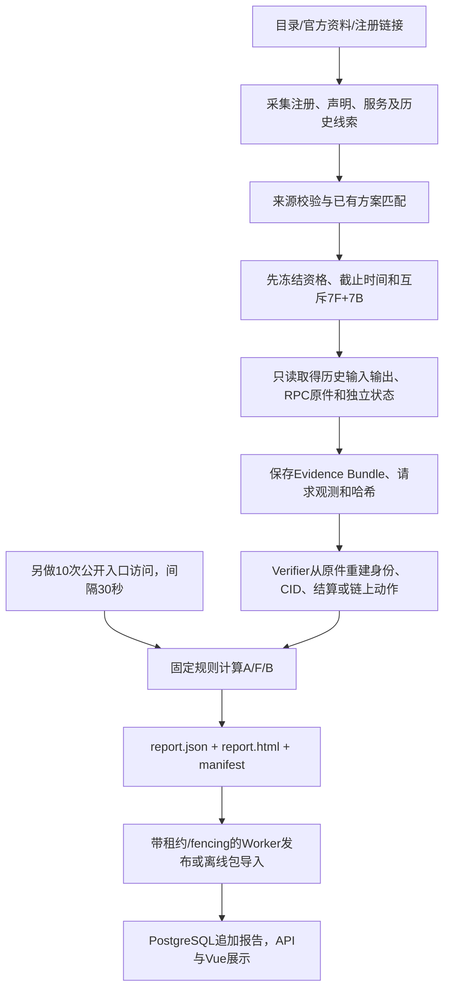

# 历史十个 Agent 评价审计与 Base 2290 单对象接入

日期：2026-10-19（北京时间）。审计工作区为当前独立仓库，HEAD=`3a680f3`、分支`main`。开始时已有LLM、ZAN、网络和本机启动的未提交修改，本轮保留。本文以实际代码、发布包、已恢复原件、PostgreSQL和Git记录为依据；旧文档中的原开发机路径、候选数、报告数和授权不能代替当前实测。

核心结论：**历史十份是有真实公开证据支持的限定范围评分，不是十次实时调用完整 Agent 能力。当前不具备对任意公开ERC-8004 Agent自动给出可信完整声誉分的能力。** 可以复用通用注册/协议发现/报告，及受严格条件限制的Gnosis历史预测/Mech履约规则。Brain增仓仍是特例。2290不属于这两种已完整评分的业务类型。

## 1. 此前十个 Agent 是怎么测评的

### 1.1 实际对象与结果

十个对象共用注册合约`0x8004a169fb4a3325136eb29fa0ceb6d2e539a432`，完整身份仍必须带链号和Agent ID。以下分数来自`data/public-reports-v1.json`、原report.json和当前数据库，并已在本轮用现有`_validated_report`重新计算一致。A/F/B分别为服务可用性、功能声明一致性、交易行为可靠性。

| 链/ID | 报告名称 | 实际已评服务/规则 | A | F | B | 综合 |
| --- | --- | --- | ---: | ---: | ---: | ---: |
| Gnosis 100 / 2135 | mekrim-krontron52 | Mech二元预测，prediction-history-v2 | 97.05 | 72.89 | 100 | 88.27 |
| Gnosis 100 / 2182 | Valory Mech Predict (Gnosis, service 2182) | Mech二元预测，v1 | 98.33 | 77.64 | 100 | 90.56 |
| Gnosis 100 / 2198 | Valory Mech Predict (Gnosis, service 2198) | Mech二元预测，v1 | 98.20 | 75.66 | 100 | 89.72 |
| Gnosis 100 / 2235 | Valory Mech Predict (Gnosis, service 2235) | Mech二元预测，v1 | 98.61 | 97.81 | 100 | 98.71 |
| Gnosis 100 / 2267 | minel-limvon01 | Mech二元预测，v2 | 99.34 | 0 | 0 | 29.80 |
| Gnosis 100 / 2340 | Valory Mech Predict (Gnosis, service 2340) | Mech二元预测，v1 | 98.51 | 79.33 | 100 | 91.28 |
| Gnosis 100 / 2359 | Valory Mech Predict (Gnosis, service 2359) | Mech二元预测，v2 | 89.79 | 68.62 | 100 | 84.39 |
| Gnosis 100 / 2360 | Valory Mech Predict (Gnosis, service 2360) | Mech二元预测，v1 | 98.33 | 72.79 | 100 | 88.62 |
| Gnosis 100 / 4110 | sokim-kejel59 | Mech二元预测，v1 | 89.69 | 53.89 | 100 | 78.46 |
| BSC 56 / 363709 | Brain on BNB — DeFi Agent | 历史增仓，liquidity-history-v1 | 93.09 | 100 | 100 | 97.93 |

这九个Gnosis身份属于同一Olas/Mech生态；九个身份不等于九个独立提供方。各自实际Mech地址、service_id、固定区块、14槽计划、实际tool分布和报告/manifest位置，保留在[逐对象证据索引](../../runtime/agent2290-audit-20261019/historical-evidence-inventory.json)。每个Agent有自己的原件，不能将另一身份的成功历史移过来。2198/2235的联合翻译依赖可以共同引用，但各自任务仍按身份核验。

### 1.2 发现、筛选和接入

- Brain从`public_targets.py`中的人工审查公开入口、8004scan目录、官方服务页和公开运行记录进入候选；最初26条观测只做准入调查，不直接计分。后续核对注册事件里的Operating wallet、记录接口与执行钱包、仓位所有权及真实三步交易。依据见`reference/CANDIDATES.md`、`docs/runbooks/MODEL_EVIDENCE_LOOP.md`和ADR-0004。
- Olas从官方客户端查询结构和Marketplace subgraph发现。`scripts/discover_olas_candidates.py`最多读取40个Mech，按已有交付量排序、按service分组；交付计数仅用于发现，不是声誉分。再以可信RPC核实registry、bridge的service→agent映射、Mech serviceId、operator及tokenURI。即使当前样本的agentId与serviceId数值相同，也不是靠数值相同推定关联。
- 早期2198/2235使用后台冻结profile、来源引用的LLM声明及离线选案；后续2340、2182、2360、4110、2135、2267、2359进入通用注册发现和自动预测附加流程，复用同一协议实现。V2补充支持经来源证明的直接原题、根文件布局和官方历史事件格式，未另建对象专属评分公式。
- 资格以可读原件、接口、身份、独立判据及可归属历史为准；缺项候选也保留。先选择有足量交付的生态会产生覆盖偏向，不能把这十个对象视作全体ERC-8004 Agent的随机代表。部分最初人工搜索过程和全部探索请求不在本机发布包中，不能逐次完整还原。

### 1.3 真实调用链



历史业务由被测Agent在过去执行，平台没有为这些报告重新付费发起预测或增仓。Worker对已有profile复评时，重新采集的是访问体验，历史任务复用未变原件并离线核验。自动预测首次接入还可以真实读取尚未留存的历史材料，但同样不是新业务任务。

Brain固定保留登记后27条含增仓步骤的记录，其中14条宣称实际执行、交替分成两个七槽组，另外13条无动作记录作为范围外背景。功能组为97/99/101/104/112/116/121；行为组为98/100/102/106/114/119/123。功能核对披露金额、仓位流动性与固定状态/同块事件；行为核对包装、兑换、增仓完整三笔及身份、金额、方向、接收者、调用参数、时间和顺序。索引123曾用于可行性验证，不能称盲测。

九个预测报告各有14个不同已结算问题，先保留资格和分组，再读预测输出；7题计算概率表现、另外7题核对完整交付，另采10个访问槽。排除两个已观察pilot市场，默认截止2026-10-01 UTC；每批固定区块和查询边界以实际profile/plan为准，不能把首批48815687当成全部报告的共同区块。V2按固定512条上限查找资格，达到14题停止；不是承诺扫全历史。历史任务可早于当前登记，但必须证明同服务与历史执行控制的连续归属，并展示登记时间。

### 1.4 LLM到底做了什么

历史模型是`deepseek-flash`，旧协议为DeepSeek `/responses`；**gpt-6-luna只是当前配置通过过推理连通性测试，没有参与这些历史分数，也没有在本轮被调用。**

早期Brain、2198、2235的声明提取使用`model_analysis.py:INSTRUCTIONS`：提取操作、输入、输出、限制和严格连续原文引用；未知内容列缺项；禁止评分、执行、虚构证据。Schema/引用验证后仍有离线语义复核。早期运行manifest和分析产物保留，但部分原始声明模型请求/响应不在恢复包中；无法仅凭当前本机材料复现其每次实际请求、总费用和全部拒绝过程。运行手册记录的模型调用/token数属于历史记录，不能冒称本轮重新验证过的提供方账单。

后期`prediction_auto_selection.py:write_auto_selection`直接从已认证tool catalog与原始输入生成带引用的声明及描述符，manifest明确`network_requests=0, model_calls=0`。并非每个新预测对象都再让LLM决定方案。

预测中文题目由LLM翻译，Prompt在`question_translation.py:TRANSLATION_INSTRUCTIONS`：只翻译/解释题干，不预测、不判断答案、不接收概率、结算方向或分数，逐字回显题目及摘要。当前引用的92份翻译缓存关联14份不同的原始翻译请求/响应，实际模型字段均为`deepseek-flash`；这是保留下来的相关请求数，不代表全部历史计费请求。缓存与人工译文修订属于离线展示材料，不是新调用Agent。详见[模型与Prompt核对记录](../../runtime/agent2290-audit-20261019/historical-model-prompts.json)。

### 1.5 三维计算完全复用现有代码

`packages/core/src/reputation_core/scoring.py`与ADR-0001/0004/0008规定：

1. A必须完整保留10槽、至少8个PASS/FAIL；UNKNOWN/N_A不被填成0或通过。成功率为PASS/(PASS+FAIL)。A=`80×成功率+20×延迟比例`，成功样本p95用nearest-rank，1000ms及以下延迟比例1、10000ms及以上0、中间线性。测到的是当时代理/线路与所测入口的体验。
2. 预测F七槽全部有确定判定：有效概率满足有限、范围及总和约束；单题信用`100×(1-(p_yes-y)^2)`，F取七题平均。50/50对应75信用分，不是75%准确率。给最终结果概率≥0.5为方向PASS；已取得且证实不合声明的输出为FAIL/0；拿不到原件或结算依据为UNKNOWN。
3. 增仓F及两类B七槽全部确定后，按PASS比例计分。预测B需要请求/交付交易、回执、事件、CID、实际Mech、service/operator、接手超时、授权、报价和顺序等归属证据，并核对约定交付，不把外层EOA或收款钱包当执行者。
4. 每个sample_id和task_key唯一，同一任务不能跨F/B计分。综合分固定`0.30A+0.40F+0.30B`，三维均充分才计算；不重新分配缺失权重。

## 2. 十个评价是否真实完整

| 环节 | 有何真实证据 | 能证明的范围 |
| --- | --- | --- |
| 当时的外部采集 | 请求计划、HTTP/RPC观测、响应字节、时间和摘要 | 当时确有取证；不证明今天仍在线 |
| 链上独立核验 | 原始tx/receipt/header、eth_call、事件、固定块、历史控制 | 程序独立重建协议事实；不是多节点共识审计 |
| 预测结算 | Omen/Reality/ConditionalTokens问题、选项和最终payout绑定 | 独立于Agent预测输出的协议结算，不是独立调查现实世界真相 |
| Evidence Bundle | 原输入输出、来源引用、固定计划、CID/CAR/DAG及哈希 | 不能只相信bundle自报PASS，要重放核验 |
| 当前本机十报告 | 发布包恢复、离线验证后入库 | 属历史归档导入，非本轮重新调用Agent |
| LLM/译文复核 | 声明/引用产物、翻译缓存及部分原始响应 | 辅助分析和展示，不直接提供最终声誉分 |
| 前端 | API读数据库JSON，展示样本、缺项与附件 | 展示本身不产生新证据 |

十份均满足各自政策的范围内样本门槛，包括2267的真实低分；`COMPLETE`不等于Agent全部能力正确。2360的10次访问中1项UNKNOWN，其余9项确定，仍满足A门槛；并没有把未知补成失败。2267七个功能输出无有效概率、七个交付内容违反已约定输出，因此F/B为0，不能概括成七次链上交易失败。

历史有实现勘误：2340由83.01离线复核到91.28，修复原题JSON转义及错误prompt回显门禁；2135补适配官方历史请求事件，原缺项补齐后88.27；4110补登记日期原件后78.46；2267说明修订后仍29.80。这些均保留旧原件/修订来源，不能称重新调用Agent。已纠正的局限不应机械复制，也不能以勘误为由改写旧分。本轮不改这些历史记录。

本轮核对了10份分数重算，以及14,696个去重历史依赖的SHA256，均一致。没有再次执行全部历史链语义核验或重复导入；该部分复用先前成功的完整离线导入收据`runtime/public-report-restore-799c7827ca73c01faec650e5573d2ad7/result.json`。本机发布包不是原开发机所有候选、所有失败调用、所有数据库版本的完整镜像。

## 3. 新Agent之前为什么无法评分

直接阻塞在`services/platform/src/reputation_platform/worker.py:evaluate`：可解析身份且没有后台profile时，`enabled=False`就立即finalize为NEEDS_INFO，原文正是“注册标识已保留。当前未启用公开采集……”。本机旧Worker启动时没有`--enable-public-readonly`；填写LLM/ZAN配置不会改变此开关。`profiles.json`本机不存在，不是登记身份失效。

此外数据库确有一份带`?utm_source=chatgpt.com`的2290旧提交被判UNSUPPORTED：`application.py:normalize_reference`拒绝带query/fragment的URL。用户此次给出的干净链接可正常识别；本轮未放宽输入URL校验。

仅启用开关仍有两层限制：

- 网络：通用Discovery使用`pin_public_dns=True`和`PinnedBackend`，旧路径拒绝Mihomo返回的Fake-IP；LLM/ZAN已能安全解析不代表该路径也已接通。本轮系统DNS实际返回api.8004scan.io=198.18.0.72、api.zan.top=198.18.0.13，原校验会拒绝。
- 业务：`evaluate_auto_prediction`首先限制Gnosis；`planning.select_prediction_plan`进一步要求支持的Mech/Omen协议、来源声明、输入输出及独立历史资格。增仓选择器要求BSC/PancakeSwap V3及指定历史结构，且Worker依赖后台已留存profile。Base上的编排Agent不能套用这些历史任务。

因此2290的正确目标是先完成注册/协议取证并发布有缺项的范围报告，不能仅把public-off改成on就承诺完整评分。

## 4. 可直接复用和仍缺少的机制

| 模块 | 已实现、可复用 | 当前边界 |
| --- | --- | --- |
| `application.py:normalize_reference` | canonical/8004scan链接解析，API入队规范化 | 支持的URL链名有限；拒绝query/fragment |
| `registration_discovery.py` | 目录、可信RPC、head-64固定块、ownerOf/tokenURI、JSON/data/IPFS元数据、原件重验 | 可信RPC仅100/56/8453；通用IPFS文档读取尚无独立CID/DAG认证；目录缓存必须标清 |
| `safe_http.py`、`pinned_http.py` | HTTPS、SSRF、IP固定、原域名TLS/Host、超时/大小/停止规则 | 不接受metadata中的RPC；代理仍固定本机7897 |
| `protocol_evaluation.py` | MCP初始化/tools/list、资料Card/OpenAPI读取、10次发现接口采样 | 不是tools/call业务执行器；SSE、会话、授权等未全面适配；OASF仅保留声明 |
| `model_analysis.py`、`claims.py` | 有出处LLM声明及引用验证 | 没有任意功能的通用业务判据；本轮未付费调用 |
| `planning.py`、`prediction_auto_selection.py` | 按实际描述/Schema/历史结构选择已支持规则 | 不按名称/ID选案；自动预测选案可以零LLM完成 |
| `prediction_auto*.py`、`prediction_evidence.py` | 支持协议的历史自动取证、冻结资格、补齐/复用原件 | Gnosis Mech普通固定价格路径和受支持Omen二元结算；订阅/签名等不承诺适用 |
| `prediction_chain.py`、`prediction_report.py` | 链身份、任务/CID、结算、概率与报告独立重建 | 必须有足量可归属历史及适用协议，非新付费预测 |
| `mech_task_collection.py`、`mech_task_evidence.py` | 部分Gnosis Mech逐工具历史履约，可复用旧原件或读取新历史 | 不把交付格式合规当通用业务答案正确 |
| `behavior.py`、`disclosure.py`、`build_liquidity_report.py` | Brain历史增仓动作/披露核验 | 窄范围特例，未有任意LP Agent自动接入闭环 |
| `scoring.py`、`reporting.py`、`evaluation_report.py` | 四态、证据门槛、固定权重、中文HTML/JSON报告 | 缺证据维度无分；通用F和多专项组合尚缺 |
| `worker.py`、`db.py`、`schema.sql`、`api.py` | 队列去重、租约续期/fencing、追加持久化、附件白名单 | Worker是独立进程；Verifier主要是被调用的Python核验函数，不是当前本机另起的万能验证服务 |
| `scripts/public_reports.py` | 公共包安全导出/恢复、依赖与分数核验、事务导入 | 离线导入不能冒充新实时评价；旧pilot导入与自动报告的复核深度有区别 |
| Vue `ReportView.vue` / `App.vue` | 历史、三维、逐功能缺项、通用服务分类 | 前端已有PARTIAL展示，无需重做界面 |

旧pilot报告通过Repository导入会校验来源摘要、身份政策和确定性评分；自动预测/通用报告还有从原件重建的核验分支。不能笼统声称每条数据库读取都重新运行全部链语义核验。发布包当前代码复用上述导入机制，本轮没有重复执行13分钟完整恢复过程。

## 5. 本轮最小修改

1. `pinned_http.py`：仅在系统DNS结果**全部**为198.18.0.0/15、且使用原本允许的本机代理时，复用现有`llm_network._doh_addresses`。DoH使用固定1.1.1.1 HTTPS并验证证书；返回值仍须全部公网，再以数字IP CONNECT，保留原域名TLS与Host。混合/私网、无代理Fake-IP仍拒绝；DNS与连接共用超时预算。未降低TLS或SSRF规则。
2. `worker.py`：新增可选`--public-reference`，只对该规范身份开启公开读取；其他身份继续public-off，不因本轮测试而开放批量测评。
3. `test_pinned_http.py`和`test_worker_scope.py`：验证上述安全边界和身份限制。三项传输测试、两项范围测试通过，均是Mock/离线工程测试，不计Agent结果。
4. README、PLAN、STATUS及本报告同步实际范围。原有三维算法、权重、阈值、历史证据、旧评分和前端代码均未修改；未加新依赖、业务执行框架或Judge评分。

## 6. Agent 2290单次真实评价

本轮唯一新增业务评价作业为`e7dcb405-22a3-4dd4-ae0f-5515048c468a`，由真实HTTP API提交、真实PostgreSQL队列和现有Worker执行。取证目录`runtime/generic-evaluation-20261019T093532Z-805ea72f`。2026-10-19 17:41:04完成，报告ID=`7377ee9b-df72-410c-9bd7-f9df6067f4d9`，Agent key=`agent-ffcbb2f3565157000c72e87e`。

**作业COMPLETE表示取证和发布结束；报告评分状态为PARTIAL。** A=90.87，10/10确定通过，p95=5109ms；F=null、B=null、综合=null。A只衡量目录所列MCP发现接口经本机代理的访问体验，既不是完整业务可用性，也不表示接口与tokenURI原件的关联已经独立认证。缺失维度没有补成0或100。

已独立取得Base链号8453、固定确认区块52806533（head52806597、64块确认距离）及注册合约`ownerOf(2290)`/`tokenURI(2290)`原始RPC响应。owner=`0x715dc035ffb97dd7bb4095c6670138ba05bb4e6d`，区块哈希=`0xffe5b7b2b408dcae8da6567127149dba69239e1321a4968a20b808d2cf7e9ce7`。tokenURI为`ipfs://bafkreifa2kvzjrtozvznce2bc3rwc7uzronxkm3w5fe2v6bjyfp52tci6e`。本次固定网关读取该文件超时，未自动重试或替换来源冒充成功；`registration_verified=true`仅表示链上注册读取成立，不等于注册JSON已经取回、缓存服务已获链上文档认证。

8004scan目录缓存显示名称Clawdia，功能为ClawPlaza协作编排、任务路由、质量检查和执行监控。目录自报Free、x402Support=false及trust类型均只是声明，不能当支付条件或TEE/信誉已核实的证明。

| 服务 | 目录给出的地址 | 本轮范围 |
| --- | --- | --- |
| MCP | `https://work.clawplaza.ai/mcp/clawdia` | initialize、initialized、tools/list；不执行tools/call |
| A2A | `https://work.clawplaza.ai/agents/clawdia/.well-known/agent-card.json` | 真实HTTP200读取Card；非A2A任务执行 |
| OASF | `https://work.clawplaza.ai/oasf/clawdia` | 当前适配器不执行该类型 |
| Web | `https://work.clawplaza.ai` | HTTP200、内容为HTML，当前JSON资料适配不适用；不把网页200当功能通过 |

MCP真实初始化HTTP200，通知204，协议协商2025-06-18；工具发现HTTP200，返回`chat`、`route_task`、`get_agent_info`及各自对象输入Schema。A2A Card实际列出Workflow Orchestration、Quality Validation、Agent Discovery三项skill，声明noauth。报告因此有六项接口/功能声明记录，并不代表六种业务已测。名称、端点和注册关联来自目录缓存；工具/skill内容已另从实际HTTP取得，仍不能据此反推IPFS文档的原始内容。

`route_task`含可选budget credits字段；没有执行可能调度其他Agent或产生费用的业务工具。仅发现工具不证明聊天质量、路由正确或任务完成。主流程共22次只读请求：目录1、RPC5、IPFS文档1（超时）、MCP初始化/通知/首次工具列表3、额外可用性采样10、A2A Card1、Web1。固定DoH解析属于另行发生的网络传输辅助，不计入22个业务/资料请求；不能将22称作全部底层HTTP报文数。本轮LLM=0、tools/call=0、付费Agent任务=0、签名=0、链上写入=0。原件、request-plan、observation及原有通用manifest构成可追溯证据集合；未虚构预测专用bundle。

匹配的是已有`service-contract-v1`通用协议方案，不是预测/增仓方案。阻止完整分的具体缺口是：未取回tokenURI注册原件；缺适用编排/路由正确性任务及独立基准；缺可归属、可核验的交易履约样本。现有纯查询/非交易能力也不能自动补成行为100分。

## 7. 后续如何继续接入其他Agent

网页可以填写解析器支持的干净8004scan链接或完整canonical；API自动规范化和入队。是否读取公网由实际Worker启动参数决定，是否有分由身份、协议适配、独立判据、原件和样本门槛共同决定。

本轮单身份Worker命令为：

```powershell
.venv/Scripts/python.exe -m reputation_platform.worker --enable-public-readonly --public-reference https://8004scan.io/agents/base/2290 --proxy http://127.0.0.1:7897
```

本轮实际加`--once`，只处理上述一次作业后退出；运行公开Worker前应确认0活动任务、按进程身份停止旧public-off Worker，不能让两者竞争消费同一队列。其他身份不会因上述范围参数自动发起外部评价。扩大范围是后续工作；当前Gnosis自动预测在就绪时可能调用问题翻译模型，必须遵守本次“付费先确认”的新要求，不能借旧DeepSeek授权自行执行。也不能直接把MCP的任意tools/call交给LLM运行，或将缺失交易证据补成通过。

**当前常驻Worker已恢复public-off。** 自动审批拒绝启动常驻公开Worker（返回`blocked by policy`，未提供更具体原因）；本轮没有绕过该拒绝留下持续公开采集进程。已生成报告仍可浏览；当前再次提交会按public-off返回缺项，不会自动重复22次取证。开启常驻自动采集尚未完成，不能声称网页对后续提交已全部启用实时评价。

可完整评分的主要自动类别是满足已实现身份/普通Mech协议、14个独立合资格历史二元问题、公开输入输出/CID、最终Omen结算及可归属链上交付的Gnosis预测服务；Brain式历史增仓仍需后台证据/profile。一般MCP服务当前可以取得资料、协议可用性与缺项报告，部分Gnosis Mech还可核验历史履约。**最关键缺失是跨业务的安全免费任务执行、实际输入输出绑定、业务特定独立正确性判据和可归属履约证据，另有元数据内容认证、更多协议/链和多能力组合的边界。**

## 8. 测试与代码状态

| 验证类别 | 实际结果 |
| --- | --- |
| Mock/离线工程测试 | `test_pinned_http.py` 3项、`test_worker_scope.py` 2项通过；公网IP/TLS/Host、私网/混合DNS拒绝、无代理Fake-IP拒绝和身份范围正确 |
| 离线历史核对 | 10份旧分重算一致；14,696个去重依赖摘要无差异；未再次联网评价这十个Agent |
| 真实外部验证 | 仅2290，22个只读请求；链身份通过、MCP通过、A2A Card通过、注册IPFS文件超时；没有业务工具执行 |
| 实际Verifier和数据库发布 | Worker正常exit0；`verify_generic_report_sources`在生成及入库中从原件核验；新报告PARTIAL真实入库 |
| 本机真实socket HTTP/PG回归 | 11 Agent/11报告，10个完整评分对象；0活动任务；原10行JSON/评分/来源摘要/附件映射和原report/manifest文件保持；逐份API及各一附件HTTP200/SHA一致；新owner原件下载校验通过 |
| 前端 | 真实浏览器显示Clawdia、部分评价、90.87、F/B/综合待评价、六项声明及逐项缺口；控制台无已记录warn/error；首页两项JS/CSS与dist字节一致 |
| 访问边界 | 私有配置路径直访及证据接口越界均404；无关闭SSRF/TLS/DNS固定保护 |
| 尚未验证/未执行 | 2290注册IPFS原件及其内容认证、chat/route_task/get_agent_info实际业务正确性、A2A任务、OASF业务、归属交易、任意公开Agent的完整自动评分、常驻公开Worker |

任何Mock均未进入2290证据或数据库报告。本轮未重复运行与改动无关的全套测试、前端构建或13分钟导入。首个离线评分检查命令误把computed scores传给extra=forbid模型而失败，随后改用已有`_validated_report`入口，十份通过；这是审计脚本使用错误，不是业务评分失败，记录在offline-check-results.json。

实际回归结果见[JSON收据](../../runtime/agent2290-audit-20261019/result.json)、[浏览器核对](../../runtime/agent2290-audit-20261019/browser-checks.json)、[页面截图](../../runtime/agent2290-audit-20261019/report-scores.jpg)、[新报告原件](../../runtime/generic-evaluation-20261019T093532Z-805ea72f/report.json)和[证据manifest](../../runtime/generic-evaluation-20261019T093532Z-805ea72f/manifest.json)。

本轮源码改动为`pinned_http.py`、`worker.py`、既有`test_pinned_http.py`及新增`test_worker_scope.py`；另更新README/PLAN/STATUS和本报告。运行审计材料位于被忽略的runtime，原十份公开包未改。开始时已有的其他未提交改动全部保留；当前仍有未提交修改，未commit、push、PR或部署。

相关Git演进：`2b71d65`历史增仓核验；`234de53`内容寻址预测及确定性范围分；`d314beb`预测平台发布；`4385363`通用服务证据/覆盖；`1791a8a`自动预测附加；`562526b`/`f00e263`V2原题/根文件及输出判据；`3091343`登记日期补证；`b038acf`历史Marketplace事件及扫描边界；`665e257`十报告发布包，`63e0401`原子导入；最终合并`3a680f3`。提交信息仅作为定位，实际结论以代码和原件为准。
