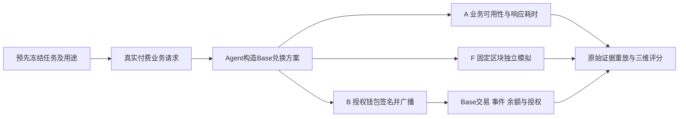

# MangoSwap 真实兑换评价记录（2026-10-27）

最新 `evm-swap-builder-v2` 报告已实际完成并导入 PostgreSQL，状态为 **COMPLETE**：服务可用性 **95.67**、功能声明一致性 **100**、交易行为可靠性 **100**，综合 **98.70**。报告ID：`59c87f4e-b202-47ff-8db1-850a03041684`；[本机浏览](http://127.0.0.1:7754/?agent=mangoswap-26345)。

报告生成于2026-10-27 04:32:46 UTC，目录为 `runtime/spraay-public-v2-20261027`。本记录的数据取自该目录的[实际报告JSON](../../runtime/spraay-public-v2-20261027/report.json)及下文最终账本。当前31个评分槽包含27个历史槽和用户批准新政策后完成的4个功能槽；七笔本金兑换均为原有交易，没有重做。完整评分所需证据已达到要求，额外付款和交易已停止。

## 对象与实际功能

本轮评价的是Ethereum ERC-8004已登记的 **MangoSwap #26345**，调用Spraay网关的兑换服务。用户提供代币、金额、收款地址和滑点，Agent生成Base链上的报价、精确代币授权和兑换calldata；经用户授权的买方钱包负责签名与广播，Base上的Uniswap V3负责实际兑换，评价平台独立读回原交易、回执、事件和资产余额核验结果。**身份注册在Ethereum，交易执行在Base（链ID 8453）**。WETH是封装ETH代币，与支付gas的原生ETH分别记账。

它是提供交易方案的Web3服务，本轮没有证明其自行持有用户私钥、自主选择投资策略或替用户托管资产。Spraay #26346、ACP同品牌对象及批量支付、AI计算等其它能力不共享这份分数。入口与登记身份的关联来自官方Agent Card声明；owner与tokenURI已核，IPFS注册正文未取得，身份来源标记仍为PROVIDER_DECLARED。



## 三个维度如何评价

| 维度 | 实际观测 | 判据 |
| --- | --- | --- |
| 服务可用性 | 10个独立付费业务访问；至少8个确定结果 | 完整业务响应、成功率与成功访问p95；目录在线或402挑战不算业务成功 |
| 功能声明一致性 | 两个完整来源组的14个独立功能槽，固定区块完整模拟 | 至少7个确定结果，且确定证据覆盖率至少80%；核链/代币/精度/整数金额/收款人/真实calldata/精确授权/最低到账与模拟结果 |
| 交易行为可靠性 | 再另外7个独立真实兑换任务 | 任务对应真实交易；成交及转账事件、资产到账、剩余授权一致，交易位于对应区块且已过至少64块 |

三组任务的UUID互斥，同一任务不跨维度重复计分。A沿用`80×成功率 + 20×延迟指标`；延迟指标在p95为1000至10000ms间线性下降，p95用成功访问的nearest-rank值。F、B分别为确定样本中的通过率：`100×PASS/(PASS+FAIL)`。UNKNOWN单列，不算成功或失败，但保留在计划槽数及证据覆盖分母中。三维充足才按30%/40%/30%合成。所有分数由公开原件重放计算。

| 最新V2结果 | 原始样本结果 | 分数 |
| --- | --- | ---: |
| 服务可用性 A | 10槽：9 PASS、1 UNKNOWN；成功访问p95为2946.7189ms | 95.67 |
| 功能声明一致性 F | 14槽：12 PASS、2 UNKNOWN；确定证据覆盖率12/14＝85.7% | 100.00 |
| 交易行为可靠性 B | 7槽：7 PASS，均有真实交易及确认记录 | 100.00 |
| 综合（30% / 40% / 30%） | 31个独立槽；状态COMPLETE | 98.70 |

A的9份确定访问均成功，延迟使其分数低于100。F的100分表示12份可判定证据全部通过；仍有2份UNKNOWN，并不表示14槽全部成功，更不代表已验证Agent声明的所有功能。v2要求 `decisive≥7` 且 `5×decisive≥4×planned`：14槽中11份确定证据不足80%，本次12份才达到出分门槛。

### 可用性样本 A01

请求是“0.05 USDC换WETH，收进自己的钱包，滑点上限0.5%”。A01真实付费业务响应为HTTP200，从正式业务POST发出到完整正文收到耗时2231.9248ms，约2.232秒，因此该条为PASS。计时不混入此前付款签名、操作者RPC准备及等待时间，也不把402付款挑战当作兑换业务成功。它反映本次访问线路的完整响应体验。

### 功能样本 F11

F11对应原复评计划的F04，UUID为`fd6d6a97-c547-40fc-a290-09fa33b7c374`；评分槽别名改变，原任务文件及UUID保持不变。请求是“0.000031 WETH换USDC，收款人仍是自己的钱包”。服务报价0.071598 USDC，编码的最低到账为0.071240 USDC；独立固定区块完整模拟得到 **0.071597 USDC**，达到最低要求，判为PASS。

平台检查实际合约调用中的Base链、输入WETH地址及18位精度、输出USDC地址及6位精度、原始整数金额、收款人、官方路由、精确授权和最低到账，再核完整模拟结果。只看服务返回“ready”或JSON字段齐全无法完成这些核验。F11是功能模拟，没有广播兑换本金交易。服务把WETH展示成ETH的标签问题仍在报告中单列披露；当前资金约束按真实代币地址和整数单位判定。

### 履约样本 B01

真实投入0.1 USDC，到账 **0.000043001356465853 WETH**，高于最低0.000042827285279623 WETH。平台从独立RPC读回实际交易和执行回执，从Uniswap官方工厂合约确认交易池地址，再核对同笔Swap成交、Transfer转账及区块前后余额：USDC减少100000个最小单位，WETH增加43001356465853个最小单位。剩余Router授权为0，既有账户委托未改变，交易已达到至少64块确认要求，因此判为PASS。

这笔交易由Agent提供方案、买方授权钱包签名执行。实际网络费为0.000000812283023536 ETH，其中L2执行费809874000000 wei、L1费2409023536 wei、同区块operator fee为0；完整费用与钱包ETH减少量一致。x402服务费另外计为USDC支出。

## 七笔真实兑换

| 样本 | 投入 | 实际到账 | 最低要求 | 链上记录 |
| --- | --- | --- | --- | --- |
| B01 | 0.1 USDC | 0.000043001356465853 WETH | 0.000042827285279623 WETH | [交易](https://basescan.org/tx/0x9b9ebb99c975109e715c78ad597139f44fe5735e29dacbb8bfb62d6a9c935135) |
| B02 | 0.00004 WETH | 0.092937 USDC | 0.092526 USDC | [交易](https://basescan.org/tx/0xc921c844b754f73ef45a6efe5d98fd4abef9120e2e2f63a1766bbf3f9e0d5b1d) |
| B03 | 0.15 USDC | 0.000064555048107612 WETH | 0.000064227637325974 WETH | [交易](https://basescan.org/tx/0x93838541c8d13e467b6cb1ea9e34a0c679d880d0919820f0482210d23d6accb3) |
| B04 | 0.00006 WETH | 0.139304 USDC | 0.138563 USDC | [交易](https://basescan.org/tx/0x3a11bcb34d6665d94616cfa6a13ed41d9c805be816eb180d930795f6c7731bdd) |
| B05 | 0.2 USDC | 0.000086040537360288 WETH | 0.000085670953925074 WETH | [交易](https://basescan.org/tx/0xf6638848afad0bb0ea6680a5f04d2dc1d8aa22d93286486a08c004aaf3022cfc) |
| B06 | 0.00008 WETH | 0.185766 USDC | 0.18485 USDC | [交易](https://basescan.org/tx/0xe2a6e90d52ffeccaf87301cf772a41cd86c6467402e44eaa5964b1434ade73d7) |
| B07 | 0.25 USDC | 0.000107546667771447 WETH | 0.000107031077514486 WETH | [交易](https://basescan.org/tx/0x28332fc435678c7093248acdafaa3233e31abe41d7ea3eeb768cc11ad75d5dc3) |

七笔买方实际网络费合计 **0.000005634637367917 ETH**，按回执L2执行费、L1费及同区块operator fee分别核算；与钱包原生ETH变化相符。兑换本金变成了USDC/WETH资产，不能把本金转出全部算作费用。x402服务费是另一笔USDC转账，单独对账，不用它充当兑换履约样本。

## 新规则如何冻结，旧报告如何保留

原24槽在v1下为A 7 PASS/3 UNKNOWN、F 6 PASS/1 UNKNOWN、B 7 PASS，原报告因此保留PARTIAL。随后完整维度复评的已发布快照也保留PARTIAL。两份目录分别为`runtime/spraay-public-original-20261027`与`runtime/spraay-public-reassessment-20261027`，原分数、原文和输入哈希都不改写。

用户批准[ADR-0024的新通用覆盖政策](../adr/0024-swap-evidence-coverage-v2.md)后，先冻结v2主批次，再执行剩余四个功能请求。新政策保留三维、权重、业务判据及链上确认要求，明确F可合并预先绑定的完整来源组，并以至少80%的确定证据覆盖率约束出分。真实FAIL仍须扣分；UNKNOWN及未执行槽仍留在覆盖分母，不能只挑成功样本。

本次绑定为：A取复评来源的完整10槽；F按原批次、复评批次顺序合并两个完整7槽；B取原批次完整7槽。因此31槽中，**27槽已有历史记录，4槽为新政策冻结后的前瞻采样**。评分F11–F14对应原复评F04–F07，只添加评分别名，不新建另一组任务或重复计费。

v2主批次为`runtime/spraay-experiments-20261027/campaign-v2-1dc2299f-e63e-43aa-b5d5-9a93c37d5bfd.json`，SHA-256为`c72610e2da3224b513f47121d563e2f707a072b56aeab2c465ba42081a49201c`。时间顺序为：

| 事项 | 实际时间（UTC；北京时间加8小时） |
| --- | --- |
| 新政策主批次冻结 | 2026-10-27 04:20:39.083233 |
| 首个待补任务F04开始执行准备 | 2026-10-27 04:23:49.486565 |
| 该任务F11的真实付费业务POST | 04:24:51.955发出，04:24:54.190完整收到 |
| 四个任务全部完成 | 04:32:20.079620 |

四次均实际取得方案并完成固定区块模拟，进程退出码均为0，新增本金交易为0。复评来源F03的传输缺源仍为UNKNOWN，已核其付款授权未使用且过期，没有重发。原七笔B交易整组沿用并重放原始证据，不再兑换一次。最新COMPLETE是用户批准新规则后的独立v2报告，不把两份旧v1 PARTIAL改写成完整结果。

## 费用、资产与收口状态

最终账本为[2026-10-27 04:34:59 UTC的安全账本](../../runtime/spraay-experiments-20261027/ledger-20261027T043241594107Z-8fa1b2/safe-ledger.json)，状态`WINDOW_LEDGER_COMPLETE`，统计窗口从Base区块53122854至53143112，未混入更早pilot。共核实 **35笔服务费，合计0.525 USDC**，其中本次四个补采任务新增 **0.060 USDC**。七笔买方兑换网络费累计仍为 **0.000005634637367917 ETH**，没有新增本金交易或买方兑换gas。

35笔服务费覆盖原批次与复评的全部已付款请求，包括未进入v2最新A窗口的旧访问；费用笔数和本报告31个评分槽的用途不同。服务费以真实USDC Transfer核验，兑换本金与网络费分列，不能把支付服务费当作兑换履约样本。

最终固定区块余额如下；三项均已与期初及已记录资产流对平，账本没有未归属收款方转账：

| 资产 | 最终余额 |
| --- | ---: |
| USDC | 0.663007 |
| WETH | 0.000540187903644028 |
| 原生ETH | 0.002993237310238374 |

本轮完整评分及对账已收口，停止多余付款。没有为提高展示分数追加交易或重做已完成样本。

本轮只使用已有USDC/WETH和既有钱包，全程未发币、未铸造身份、未更改钱包权限或账户委托。

## 公开分发与历史恢复

新公开包已实际生成：[data/public-reports-swap-v3.tar.gz](../../data/public-reports-swap-v3.tar.gz)。归档大小1433852字节，文件清单3200项，SHA-256为`a9a161f82eed34e4676cfea263a7e132071ddbf5fa6bd291b4ace5f93a9d6933`。既有`public_reports.py verify`已执行，退出码0、无网络请求；本次文档更新不重复运行验收。

包的`index.reports`只列最新一份V2 COMPLETE，正常导入默认仅将它加入PostgreSQL；两份旧PARTIAL作为`historical_attachments`及其全部公开依赖恢复到文件系统，状态不伪装、不自动入库。恢复阶段校验附件文件完整性，需要旧报告出现在新环境的历史列表时，再选择执行既有目录导入：

```powershell
uv run --env-file .env --no-sync python scripts/public_reports.py import data/public-reports-swap-v3.tar.gz

# 可选：重放并导入两份历史PARTIAL
uv run --env-file .env --no-sync python scripts/import_local_report.py runtime/spraay-public-original-20261027
uv run --env-file .env --no-sync python scripts/import_local_report.py runtime/spraay-public-reassessment-20261027
```

本机两份历史报告ID分别为`382bcb43-5a16-40de-bdcc-a55d7c659694`与`ed426474-5391-4a4a-a48a-77dce25ddd7e`。包中的源UUID用于溯源，新环境导入可生成不同本地ID。公开包不含付款头、付款签名、原始已签交易或密钥；浏览、离线核验这些已有报告不需要新增RPC或LLM支出。
