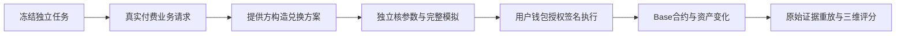

# MangoSwap 真实兑换评价记录（2026-10-27）

最新报告已保存为 **PARTIAL**，本轮完整评分目标未达到，后续付款已停止。报告ID：`ed426474-5391-4a4a-a48a-77dce25ddd7e`；[本机浏览](http://127.0.0.1:7754/?agent=mangoswap-26345)。

## 对象与实际功能

本轮评价的是Ethereum ERC-8004已登记的 **MangoSwap #26345**，调用Spraay网关的兑换服务。用户提供代币、金额、收款地址和滑点，服务生成Base链上的报价、精确授权和兑换方案；依据用户授权，由买方钱包签名执行，平台独立检查结果。注册在Ethereum，实际业务在Base执行。WETH是封装ETH代币，与支付gas的原生ETH分别记账。

它是提供交易方案的Web3服务，本轮没有证明其自行持有用户私钥、自主选择投资策略或替用户托管资产。Spraay #26346、ACP同品牌对象及批量支付、AI计算等其它能力不共享这份分数。入口与登记身份的关联来自官方Agent Card声明；owner与tokenURI已核，IPFS注册正文未取得，身份来源标记仍为PROVIDER_DECLARED。

## 三个维度如何评价

| 维度 | 实际观测 | 判据 |
| --- | --- | --- |
| 服务可用性 | 10个独立付费业务访问；至少8个确定结果 | 完整业务响应、成功率与成功访问p95；目录在线或402挑战不算业务成功 |
| 功能声明一致性 | 另外7个独立请求，固定区块完整模拟 | 链/代币/精度/整数金额/收款人/真实calldata/精确授权/最低到账与模拟结果一致 |
| 交易行为可靠性 | 再另外7个独立真实兑换任务 | 任务对应真实交易；成交及转账事件、资产到账、剩余授权一致，交易位于对应区块且已过至少64块 |

三组任务互不灌入评分分母。A沿用`80×成功率 + 20×延迟指标`；延迟指标在p95为1000至10000ms间线性下降，p95用成功访问的nearest-rank值。F、B分别为确定样本中的通过率。通过率为`PASS/(PASS+FAIL)`，UNKNOWN单列，不算成功也不算失败；覆盖门槛另行检查。三维充足才按30%/40%/30%合成。所有分数由公开原件重放计算。

| 本轮结果 | 分数 |
| --- | ---: |
| 服务可用性 | 95.67 |
| 功能声明一致性 | 未出分 |
| 交易行为可靠性 | 100.0 |
| 综合（30% / 40% / 30%） | 未出分 |

### 可用性样本 A01

新窗口A01真实业务响应为HTTP200，请求至完整正文耗时约2.232秒。计时不混入此前付款签名和操作者RPC准备，也不把RPC可访问当作Agent可用。它是该条线路下的访问体验，不是纯服务器计算耗时。

### 功能样本 F01

请求为0.11 USDC换WETH。服务给出的最低到账为0.000047275042316761 WETH；独立完整调用模拟得到0.000047512605343479 WETH，官方Quoter同区块结果为0.000047512605343479 WETH。除了金额，还核真实交易收款人、路由、精确授权和链上代币精度。此任务仅模拟，不转出兑换本金。

### 履约样本 B01

真实投入0.1 USDC，到账0.000043001356465853 WETH，高于最低0.000042827285279623 WETH。平台从独立RPC读回实际交易和执行回执，从Uniswap官方工厂合约确认交易池地址，再核对同笔成交、代币转账及区块前后余额。剩余Router授权为0，既有账户委托未改变。

## 七笔真实兑换

| 样本 | 投入 | 实际到账 | 最低要求 | 链上记录 |
| --- | --- | --- | --- | --- |
| B01 | 0.1 USDC | 0.000043001356465853 WETH | 0.000042827285279623 WETH | [交易](https://basescan.org/tx/0x9b9ebb99c975109e715c78ad597139f44fe5735e29dacbb8bfb62d6a9c935135) |
| B02 | 0.00004 WETH | 0.092937 USDC | 0.092526 USDC | [交易](https://basescan.org/tx/0xc921c844b754f73ef45a6efe5d98fd4abef9120e2e2f63a1766bbf3f9e0d5b1d) |
| B03 | 0.15 USDC | 0.000064555048107612 WETH | 0.000064227637325974 WETH | [交易](https://basescan.org/tx/0x93838541c8d13e467b6cb1ea9e34a0c679d880d0919820f0482210d23d6accb3) |
| B04 | 0.00006 WETH | 0.139304 USDC | 0.138563 USDC | [交易](https://basescan.org/tx/0x3a11bcb34d6665d94616cfa6a13ed41d9c805be816eb180d930795f6c7731bdd) |
| B05 | 0.2 USDC | 0.000086040537360288 WETH | 0.000085670953925074 WETH | [交易](https://basescan.org/tx/0xf6638848afad0bb0ea6680a5f04d2dc1d8aa22d93286486a08c004aaf3022cfc) |
| B06 | 0.00008 WETH | 0.185766 USDC | 0.18485 USDC | [交易](https://basescan.org/tx/0xe2a6e90d52ffeccaf87301cf772a41cd86c6467402e44eaa5964b1434ade73d7) |
| B07 | 0.25 USDC | 0.000107546667771447 WETH | 0.000107031077514486 WETH | [交易](https://basescan.org/tx/0x28332fc435678c7093248acdafaa3233e31abe41d7ea3eeb768cc11ad75d5dc3) |

七笔买方实际网络费合计 **0.000005634637367917 ETH**，按回执L2执行费、L1费及同区块operator fee分别核算；与钱包原生ETH变化相符。兑换本金变成了USDC/WETH资产，不能把本金转出全部算作费用。x402服务费是另一笔USDC转账，单独对账，不用它充当兑换履约样本。

## 原窗口与复评为何分开

原24槽：A为7PASS/3UNKNOWN，F为6PASS/1UNKNOWN，B为7PASS，因此原报告保留PARTIAL，A/F及综合分为null，B=100。原报告与全部受阻槽位在`runtime/spraay-public-original-20261027`，没有被新成功覆盖。

新窗口在第一条新请求前冻结10A与7F的新UUID，原B7整组逐项引用并重新重放，交易不重做。A05连接重置的UNKNOWN也保留；其付款授权过期后已独立核为未使用，未再次付款。报告必须分别说明新A/F和原B的时间，不能把它说成24个新执行任务。该按需复评见ADR-0023，评分公式、三维和门槛均未降低。

两个功能窗口合计8个独立任务的约束与模拟均一致，但原政策不能把两个不足的7槽窗口合并成完整分。两个计划共14槽：8个确定、2个真实传输缺源、4个未执行，后两类分别说明。当前没有修改政策来追认完整分。

## 费用与当前停止点

本轮31次服务费已由独立USDC转账核实，合计 **0.465 USDC**；7笔兑换的买方网络费为 **0.000005634637367917 ETH**。固定区块53126771的最终余额：0.723007 USDC、0.000540187903644028 WETH、0.002993237310238374 ETH。三项余额都与初始值加本轮全部已记录资产流精确对应，没有未归属扣款。

后续付款和交易已停止，等待用户决定是否修订通用补采政策。采样复盘与具体提案见[补采建议](../research/SWAP_SAMPLING_REVIEW_20261027.md)，该提案尚未生效。现有报告与原件均保留；已有7笔兑换不会为补功能证据而重做。

本轮只使用已有USDC/WETH和既有钱包，全程未发币、未铸造身份、未更改钱包权限或账户委托。
